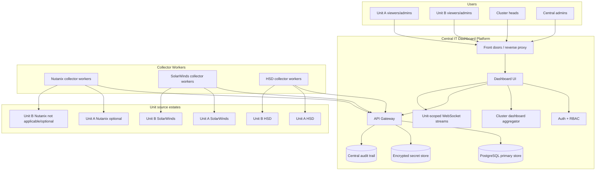

# Central Multi-Unit RBAC Architecture Plan

| Field | Value |
| --- | --- |
| Document ID | UAIL-ITDASH-CENTRAL-RBAC-001 |
| Status | Finalized architecture approach |
| Scope | Central deployment, multi-unit and cluster dashboards, RBAC, source separation, data isolation, collector topology |
| Date | 2026-11-05 |
| Code changes made for this branch | Initial central-domain schema, read-only unit/cluster gateway APIs, cluster rollup summary, and Next.js proxy routes |

## 1. Executive Decision

The application can evolve from a single-unit wallboard into a centrally deployed multi-unit platform, but the change is an architecture migration. It should not be treated as a UI filter change.

The recommended target is:

- one central application deployment
- one central PostgreSQL-backed operational data store
- multiple units modeled as first-class tenants
- clusters modeled as first-class aggregation groups above units
- each unit owning its own HSD and SolarWinds configuration, with Nutanix enabled only for units that actually have a Nutanix/Prism estate
- centralized RBAC that maps users to one or more units, clusters, and roles
- cluster heads able to see multiple assigned units in a single dashboard
- collector runs tagged by unit and source target
- dashboard state, assets, telemetry, audit, sessions, and source settings partitioned by unit

Do not proceed with JavaScript migration or Next.js removal as part of this workstream. Keep the current TypeScript and Next.js structure while changing the product architecture underneath it.

## 2. Current Architecture Summary

The current application is single-unit by design:

| Current area | Current behavior |
| --- | --- |
| Dashboard state | One merged state key: `dashboard_state` |
| Source config | One Nutanix primary target, SolarWinds servers/networks targets, and one Symphony target |
| Auth | Two local application principals: `admin` and `operator` |
| Session token | Carries email, role, expiry only |
| Roles | `viewer` and `admin` |
| Cluster view | Not present |
| Storage baseline | SQLite-first local runtime store |
| PostgreSQL | Present as future/optional mirror, not tenant-aware |
| Collectors | One process per source type, posting to `/api/update` without unit identity |
| UI | One operator dashboard and one admin surface |
| Deployment | One Windows host/VM with PM2 processes and local runtime files |

This is a good local deployment model, but central multi-unit deployment needs a stronger isolation boundary.

## 3. Target Architecture



## 4. Core Architecture Changes

### 4.1 Unit Remains the Data Boundary

Add a `unit` concept as the core tenant and data-isolation boundary.

Minimum unit fields:

| Field | Purpose |
| --- | --- |
| `unit_id` | Stable machine key, such as `utkal`, `renukoot`, `muri` |
| `unit_code` | Human-readable short code |
| `unit_name` | Display name |
| `enabled` | Operational enable/disable switch |
| `timezone` | Unit-local time display and reporting |
| `metadata_json` | Optional structured operational metadata |

Every unit-scoped record must include `unit_id`.

### 4.2 Cluster Becomes an Aggregation Boundary

Add a `cluster` concept above units. A cluster is not the storage boundary; it is an authorized grouping used for dashboards, RBAC, reporting, and escalation views.

Minimum cluster fields:

| Field | Purpose |
| --- | --- |
| `cluster_id` | Stable machine key, such as `east`, `west`, `alumina`, or `cluster-1` |
| `cluster_code` | Human-readable short code |
| `cluster_name` | Display name |
| `enabled` | Operational enable/disable switch |
| `sort_order` | Dashboard ordering |
| `metadata_json` | Optional structured metadata |

Relationship:

```text
cluster
  -> cluster_unit
       -> unit
```

The same unit should normally belong to one operational cluster for cluster-head reporting. If matrix reporting is needed later, the `cluster_unit` table can support multiple memberships, but the first implementation should enforce one primary cluster per unit unless the business explicitly needs otherwise.

### 4.3 PostgreSQL Becomes the Primary Runtime Store

Central deployment should not use SQLite as the primary multi-unit store. SQLite can remain as a local fallback/cache for single-unit deployments, but central deployment needs PostgreSQL as primary.

Tables that need `unit_id` or equivalent partitioning:

| Existing concept | Required central change |
| --- | --- |
| `dashboard_state_current` | Primary key becomes `(unit_id, state_key)` |
| `dashboard_state_snapshot` | Add `unit_id` and index by `(unit_id, state_key, captured_at)` |
| `section_health_history` | Add `unit_id` |
| `gateway_ingest_event` | Add `unit_id`, `source_target_id`, `collector_instance_id` |
| `collector_run` | Add `unit_id`, `source_target_id`, `collector_instance_id` |
| `asset_current_state` | Primary key becomes `(unit_id, asset_id)` |
| `asset_telemetry_history` | Add `unit_id`; unique key includes `unit_id` |
| `asset_status_history` | Add `unit_id` |
| `collector_target_config` | Add `unit_id`; unique key becomes `(unit_id, source_name, target_name)` or `(unit_id, config_key)` |
| `collector_secret_config` | Add `unit_id`; secret uniqueness includes `unit_id` |
| `app_user` | Keep global user identity |
| `app_action_audit` | Add `unit_id` and keep nullable for central/system actions |
| New `cluster` / `cluster_unit` | Add cluster-level aggregation and authorization boundary |
| New cluster RBAC tables | Map users to cluster-head/cluster-view roles |

### 4.4 RBAC Expands Beyond `admin` and `operator`

The current two-user model should be replaced with user-to-unit role assignment.

Recommended role model:

| Role | Scope | Capabilities |
| --- | --- | --- |
| `platform_admin` | Global | Manage units, users, all source configs, global audit, platform services |
| `central_viewer` | Global read | View all units, no source/credential changes |
| `cluster_head` | Cluster-scoped | View all assigned cluster units in a combined dashboard and drill into each unit |
| `cluster_admin` | Cluster-scoped | Manage assigned cluster unit source settings if delegated by platform admins |
| `unit_admin` | Unit-scoped | Manage assigned unit source settings, sessions, collector recovery |
| `unit_operator` | Unit-scoped | View assigned unit dashboard and freshness/status |
| `global_auditor` | Global | Read audit and export reports across all units and clusters |
| `cluster_auditor` | Cluster-scoped | Read audit and export reports for units in an assigned cluster |
| `unit_auditor` | Unit-scoped | Read audit and export reports for an assigned unit |

Recommended RBAC tables:

| Table | Purpose |
| --- | --- |
| `app_user` | Global identity, email/login, display name, enabled flag |
| `app_role` | Role catalog |
| `app_user_unit_role` | Mapping of user to unit and role |
| `app_user_cluster_role` | Mapping of user to cluster and role |
| `app_user_global_role` | Global roles such as `platform_admin` |
| `app_session` | Optional server-side session tracking and revocation |

Session tokens should not rely only on embedded role strings. For central deployment, either:

1. keep small signed cookies with `user_id`, `session_id`, and expiry, then resolve permissions server-side; or
2. include unit/role claims in the token but still re-check server-side for admin actions.

Recommended approach: server-side permission lookup.

### 4.5 Cluster Head Dashboard Behavior

Cluster heads should not have to open one unit at a time to understand operational state. They need a single dashboard that summarizes all authorized units, then allows drill-down.

Cluster dashboard requirements:

| Area | Required behavior |
| --- | --- |
| Unit summary strip | One tile per assigned unit with overall health, last sync, and source failure count |
| HCI rollup | Aggregate Nutanix cluster health across assigned units while preserving per-unit drill-down |
| Network rollup | Show critical/down links across all assigned units first |
| Server rollup | Show total/critical/degraded/down counts by unit, platform, and OS |
| HSD rollup | Aggregate incidents, service requests, SLA risk, P1/P2, onboarding, and security queues |
| Freshness rollup | Surface stale/error sources per unit so one failed collector does not hide inside totals |
| Drill-down | Clicking a unit opens the existing unit dashboard for that unit |

Cluster dashboard data rules:

- never merge assets from different units without preserving `unit_id`
- aggregated counts must show the contributing units
- freshness must be computed per unit, then rolled up
- source-of-truth rules still run inside each unit before aggregation
- a cluster head sees only assigned clusters and their member units

### 4.6 Source Configuration Becomes Unit-Scoped

Each unit gets its own source targets. HSD and SolarWinds are expected baseline sources for most/all units; Nutanix is optional because not every unit has a Nutanix/Prism estate.

| Source | Availability model | Unit-scoped examples |
| --- | --- | --- |
| HSD | Baseline | Central HSD identity/session plus approved workgroup mapping per unit |
| SolarWinds | Baseline | Unit-specific server view endpoint, network view endpoint, monitored servers, network object IDs, interface IDs |
| Nutanix | Optional per unit | Unit-specific Prism endpoint, username, password, certificate behavior; disabled/not-applicable for units without Nutanix |

Use this logical model:

```text
unit
  -> collector_source
       -> source_target
            -> source_secret
            -> session_state
            -> collector_run
            -> section_health
            -> normalized_assets
```

The key should not be only `nutanix:primary`; it should include unit context, for example:

```text
utkal:nutanix:primary
utkal:solarwinds:servers
utkal:solarwinds:networks
utkal:symphony:primary
renukoot:nutanix:primary
renukoot:solarwinds:servers
renukoot:solarwinds:networks
renukoot:symphony:primary
```

For units without Nutanix:

- `nutanix:primary` should be absent or explicitly marked `not_applicable`.
- server source of truth becomes SolarWinds for that unit.
- HCI/Nutanix panels should be hidden or shown as `Not applicable`, not as stale/error.
- cluster rollups should count Nutanix coverage separately from unit health so non-Nutanix units do not reduce cluster health.

#### 4.6.1 SolarWinds and Infrastructure Target Mapping

The current implementation still carries Utkal-specific SolarWinds defaults:

| Current hardcoded/default area | Current behavior | Multi-unit issue |
| --- | --- | --- |
| SolarWinds server names | Collector has a default list of Utkal server hostnames. | Other units need different server lists and stable identifiers. |
| SolarWinds server node map | Collector has fallback server `nodeId` values for those Utkal servers. | Name matching alone is fragile; node IDs differ by unit/Orion instance. |
| SolarWinds network node map | Collector has default network objects such as `N:1419`, `N:1417`, `N:401`, `N:402`, plus interface IDs for SDWAN details. | Every unit needs its own network nodes, interface IDs, labels, link type, and circuit metadata. |
| Admin UI metadata | Current admin settings allow free-text `monitoredServers` and `networkObjectIds`. | Free text is acceptable for a single unit, but not enough for central governance, validation, reuse, or cluster views. |

Feasibility: good. The collector already accepts runtime metadata for:

- `monitoredServers` on the SolarWinds `servers` target
- `networkObjectIds` on the SolarWinds `networks` target
- per-target `targetUrl`, `host`, and `pollIntervalSeconds`

However, central multi-unit operation should move from free-text metadata to structured target configuration.

Recommended model: master templates plus unit bindings.

| Layer | Purpose | Example |
| --- | --- | --- |
| Source template | Reusable collector behavior for a source/target type. | `solarwinds-server-template`, `solarwinds-network-template`, `nutanix-prism-template`. |
| Unit source target | Unit-specific endpoint/session/credential boundary. | Unit A uses SolarWinds servers host `10.x.x.45`; Unit B uses another host or the same central Orion with different nodes. |
| Unit asset binding | Exact assets to poll for that unit. | Server node `N:651` as `HIL-HIDDOR-AV01`, network node `N:1419` as `RJIO ISP1`, interface `I:4744` as `SDWAN-A`. |
| Display mapping | Business label and dashboard grouping. | Provider, circuit ID, site, link type, server role, criticality. |
| Validation state | Whether the configured node can be reached and parsed. | `valid`, `missing`, `permission_denied`, `renamed`, `stale`, `duplicate`. |

Suggested tables/config objects:

| Object | Purpose |
| --- | --- |
| `collector_source_template` | Defines reusable source type behavior, parser version, required fields, and default poll interval. |
| `unit_source_target` | Unit-scoped endpoint/session/credential target, replacing global `solarwinds:servers` and `solarwinds:networks` keys. |
| `unit_source_asset_binding` | Exact assets to poll under a unit target: server node IDs, network node IDs, interface IDs, display labels, and metadata. |
| `unit_source_asset_validation` | Last validation result for each binding. |
| `source_asset_template` | Optional reusable expected pattern, for example `dual-ISP + dual-SDWAN` network layout. |

SolarWinds binding schema should support:

| Field | Servers | Networks |
| --- | --- | --- |
| `unit_id` | Required | Required |
| `target_name` | `servers` | `networks` |
| `asset_key` | Stable dashboard key, for example `utkal-server-av01` | Stable dashboard key, for example `utkal-rjio-isp1` |
| `solarwinds_node_id` | Numeric ID from `N:xxxx` | Numeric ID from `N:xxxx` |
| `solarwinds_interface_id` | Optional volume/interface detail when needed | Optional but required for SDWAN/interface detail pages |
| `display_name` | Server name shown on dashboard | Link/provider name shown on dashboard |
| `match_name` | Hostname/SysName aliases used for fallback discovery | Optional node/interface alias |
| `role` | `domain`, `file`, `backup`, `app`, `db`, etc. | `carrier`, `sdwan`, `mpls`, `internet`, etc. |
| `criticality` | `critical`, `standard`, `low` | `critical`, `standard`, `low` |
| `enabled` | Include/exclude from polling | Include/exclude from polling |
| `metadata_json` | OS/platform/site/custom grouping | circuit ID, bandwidth, provider, site, link type |

Collector runtime shape should evolve from:

```json
{
  "targets": {
    "servers": {
      "metadata": {
        "monitoredServers": ["SERVER-A", "SERVER-B"]
      }
    },
    "networks": {
      "metadata": {
        "networkObjectIds": ["N:1419", "N:1417"]
      }
    }
  }
}
```

to:

```json
{
  "unitId": "utkal",
  "targets": {
    "servers": {
      "targetUrl": "http://10.36.91.45/Orion/SummaryView.aspx?ViewID=1",
      "assets": [
        {
          "assetKey": "utkal-av01",
          "displayName": "HIL-HIDDOR-AV01",
          "solarwindsNodeId": 651,
          "matchNames": ["HIL-HIDDOR-AV01.abgplanet.abg.com"],
          "role": "antivirus",
          "criticality": "critical"
        }
      ]
    },
    "networks": {
      "targetUrl": "http://10.36.91.46/Orion/SummaryView.aspx?ViewID=1",
      "assets": [
        {
          "assetKey": "utkal-rjio-isp1",
          "displayName": "RJIO ISP1",
          "solarwindsNodeId": 1419,
          "role": "carrier",
          "provider": "RJIO"
        },
        {
          "assetKey": "utkal-sdwan-a",
          "displayName": "HIL-UTK-EC-1",
          "solarwindsNodeId": 401,
          "solarwindsInterfaceId": 4744,
          "role": "sdwan"
        }
      ]
    }
  }
}
```

This supports both choices:

1. A **master template** defines that a typical unit has server assets, two carrier links, and two SDWAN links.
2. Each **unit binding** decides the actual SolarWinds `N:xxxx` and optional `I:xxxx` objects to parse.

Implementation decision:

- Do not keep long-term hardcoded Utkal server/network lists inside the collector.
- Keep the current defaults only as bootstrap/fallback for the existing Utkal deployment.
- Move the real multi-unit source of truth into PostgreSQL-backed unit source targets and asset bindings.
- Treat SolarWinds node ID as the primary identity and names/labels as display or validation fields.
- For servers, allow discovery by name as a helper, but do not rely on it as the only identity.
- For networks, require explicit node IDs and interface IDs where interface detail pages are needed.

Required validation before a unit goes live:

| Check | Required result |
| --- | --- |
| Server node validation | Each configured server `N:xxxx` resolves to an Orion node and returns status/details/perf metrics. |
| Server name parity | Returned Orion name/SysName matches an approved alias for the configured server. |
| Network node validation | Each configured network `N:xxxx` resolves and returns status/availability. |
| Interface validation | Each configured `I:xxxx` interface detail page returns expected utilization/speed fields. |
| Duplicate detection | Same SolarWinds node/interface cannot be active under two units unless explicitly marked shared. |
| RBAC visibility | Unit admins only see/edit their unit bindings; platform admins can manage templates and cross-unit duplicates. |

UI implication: there should be separate configuration screens for infrastructure targets, not only HSD.

- **Templates screen:** define reusable source target templates and default asset roles.
- **Unit source targets screen:** configure Nutanix Prism, SolarWinds servers host, and SolarWinds networks host per unit.
- **Unit asset binding screen:** assign exact servers and network nodes/interfaces to the unit.
- **Validation screen:** test selected node IDs, show returned names/status, and flag mismatches before saving/enabling.
- **Import workflow:** allow paste/import from CSV with columns such as `unit_id`, `asset_type`, `display_name`, `node_id`, `interface_id`, `role`, `provider`, `criticality`.

#### 4.6.2 Onboarding Workflow for Units and Assets

Onboarding should be an explicit workflow with validation and approval gates. It should not be a direct edit to a collector config file.

There are four common onboarding/change paths:

1. Add a new unit.
2. Add new servers to a new or existing unit.
3. Add new network nodes/interfaces to a new or existing unit.
4. Decommission, rename, or move an asset between units.

##### New Unit Onboarding

New unit onboarding creates the unit container first, then attaches sources and assets.

| Step | Owner | Result |
| --- | --- | --- |
| 1. Create unit profile | Platform admin | `business_unit` row exists with unit name, code, region/cluster, enabled state, and owner metadata. |
| 2. Assign RBAC | Platform admin / cluster admin | Unit admins/operators/auditors and cluster-head visibility are assigned before data is exposed. |
| 3. Configure source endpoints | Platform admin / unit admin | Nutanix Prism target, SolarWinds servers target, SolarWinds networks target, and HSD workgroup mapping are configured or marked not applicable. |
| 4. Attach templates | Platform admin | Unit receives default templates such as `dual-ISP + dual-SDWAN`, `standard-server-watch`, or site-specific variants. |
| 5. Import asset bindings | Platform admin / unit admin | Server node IDs, network node IDs, interface IDs, HSD workgroups, and display metadata are staged in disabled/draft state. |
| 6. Validate live sources | Platform admin / collector operator | Every source target and asset binding is checked against the live source system. |
| 7. Approve and enable | Platform admin or delegated cluster admin | Validated assets become active for polling. |
| 8. Run initial collection | Collector | First successful Nutanix/SolarWinds/HSD snapshots are stored under the new unit only. |
| 9. Parity review | Unit admin / platform admin | Values are compared with source UI for sample servers, links, and HSD queues. |
| 10. Publish dashboard | Platform admin | Unit becomes visible to assigned users and cluster dashboards. |

New units should support these states:

| State | Meaning |
| --- | --- |
| `draft` | Unit exists, but no dashboard data is exposed. |
| `configuring` | Source endpoints and asset bindings are being entered/imported. |
| `validating` | Live source validation is running or waiting for corrections. |
| `ready` | Required sources/assets validated, waiting for approval. |
| `active` | Unit is visible and included in dashboards. |
| `suspended` | Unit exists but is hidden from normal collection/display. |

##### Server Onboarding

Server onboarding should prefer stable source IDs over names.

| Step | Required behavior |
| --- | --- |
| Add server binding | User enters/imports display name, SolarWinds `N:xxxx`, optional aliases, role, platform, criticality, and expected unit. |
| Validate node ID | Gateway/collector calls SolarWinds node APIs and confirms the node exists. |
| Validate returned identity | Returned Orion caption/SysName/IP must match an approved alias or be explicitly accepted. |
| Validate metrics | CPU, memory, disk, status, availability, and boot/details probes return usable values where expected. |
| Duplicate check | Same SolarWinds node cannot be active under another unit unless explicitly marked shared. |
| Enable polling | Binding moves from `draft` to `active`; next collector cycle includes it. |
| Dashboard verification | Server appears under the correct unit with source/freshness labels. |

Server binding states:

| State | Meaning |
| --- | --- |
| `draft` | Entered but not validated. |
| `valid` | Live source validation passed. |
| `active` | Included in collection and dashboards. |
| `validation_failed` | Node not reachable, mismatched, unauthorized, or missing required metrics. |
| `disabled` | Retained for history but excluded from collection/display. |
| `retired` | Decommissioned asset; no new polling, historical data retained according to retention policy. |

##### Network Node and Interface Onboarding

Network onboarding needs both node-level and interface-level validation when interface details are required.

| Step | Required behavior |
| --- | --- |
| Add network binding | User enters/imports provider/display name, role, SolarWinds `N:xxxx`, optional `I:xxxx`, bandwidth/circuit metadata, and criticality. |
| Validate node ID | SolarWinds node endpoint confirms the node exists and returns status/IP/name. |
| Validate interface ID | If `I:xxxx` is supplied, interface detail page/API confirms alias, speed, utilization, admin/operational status. |
| Validate role expectations | `carrier` links can work with node status/availability; `sdwan` links should usually include interface detail. |
| Duplicate check | Same active node/interface cannot be assigned to another unit unless marked shared. |
| Enable polling | Binding becomes active and is included in the unit's network section. |
| Dashboard verification | Link appears with correct provider, circuit/site label, utilization, and freshness. |

Network bindings should support replacement without losing history. For example, if `RJIO ISP1` changes from node `N:1419` to `N:2001`, create a new binding version and close the old one with `valid_to`.

##### HSD Workgroup Onboarding

HSD onboarding follows the same principle as SolarWinds binding:

| Step | Required behavior |
| --- | --- |
| Discover workgroup | Central HSD Reports/API discovery lists workgroup ID/name. |
| Map to unit | Platform admin maps the workgroup to exactly one unit or marks it shared/ignored with justification. |
| Validate reports | Incident/SR/MTTR reports contain rows/counts for the mapped workgroup. |
| Enable collection | Workgroup becomes eligible for aggregation into that unit. |
| Quarantine unmapped rows | Any report row for an unknown workgroup is ignored and surfaced as an admin action item. |

##### Onboarding UI Requirements

| UI area | Required capability |
| --- | --- |
| Onboarding wizard | Step-by-step flow for creating a unit, attaching sources, importing assets, validating, approving, and publishing. |
| Bulk import | CSV paste/upload for servers, network links, and HSD workgroups. |
| Validation queue | Shows failed/missing/renamed/duplicate assets with suggested corrections. |
| Diff/approval view | Shows what will be added, changed, disabled, or moved before commit. |
| Rollback | Allows disabling newly added bindings or reverting to the previous binding version. |
| Audit trail | Records who added/approved/enabled each unit/source/asset binding. |

##### CSV Import Shapes

Server import:

```text
unit_id,asset_type,display_name,solarwinds_node_id,aliases,role,platform,criticality,enabled
utkal,server,HIL-HIDDOR-AV01,651,HIL-HIDDOR-AV01.abgplanet.abg.com,antivirus,on-prem,critical,true
```

Network import:

```text
unit_id,asset_type,display_name,solarwinds_node_id,solarwinds_interface_id,provider,role,circuit_id,bandwidth,criticality,enabled
utkal,network,RJIO ISP1,1419,,RJIO,carrier,CKT-123,100 Mbps,critical,true
utkal,network,HIL-UTK-EC-1,401,4744,SDWAN,sdwan,,100 Mbps,critical,true
```

HSD workgroup import:

```text
unit_id,hsd_workgroup_id,hsd_workgroup_name,metric_scope,enabled
utkal,50,Utkal_IT Support,incident_sr_mttr,true
```

##### Change and Decommission Rules

| Change | Rule |
| --- | --- |
| Server renamed in SolarWinds | Keep same node ID; update aliases/display name after validation. |
| Server replaced with new node ID | Create a new binding version; retire old binding. |
| Network circuit moved to new node/interface | Create a new binding version; preserve old history under old binding. |
| Asset moved between units | Require platform admin approval and audit because historical ownership and RBAC visibility may change. |
| Duplicate asset detected | Block enablement unless marked shared with explicit reason. |
| Source unavailable during onboarding | Keep binding in `validation_failed` or `pending_validation`; do not expose live dashboard data. |

Onboarding success criteria:

- unit has assigned RBAC and cluster membership
- required source targets validate
- required asset bindings validate
- first collector run succeeds or records a scoped, visible source error
- dashboard shows the unit with correct freshness and no cross-unit data
- audit trail captures every onboarding action

### 4.7 Collector Topology Changes

There are two feasible collector deployment patterns.

#### Option A: Central Collector Workers

All collectors run on the central server and poll each unit's sources.

Pros:

- simpler deployment
- one place for logs and recovery
- easier version control
- easier RBAC/admin integration

Cons:

- central server needs network reachability to every unit source
- HSD/SolarWinds browser sessions for many units live on one server
- one collector host can become a bottleneck

#### Option B: Unit-Side Collector Agents

Small collector agents run near each unit source and push telemetry to the central API.

Pros:

- avoids cross-network access from central server to every source
- isolates browser session state per unit
- scales better operationally for many units
- reduces blast radius if one unit's collector environment breaks

Cons:

- more deployment points
- requires collector agent registration and token management
- more complicated upgrade process

Recommended target: support both, but implement central collector workers first if all source systems are reachable from the central server. Design the ingestion API as if remote agents may come later.

### 4.7.1 HSD Headless Session Constraint

HSD/Symphony must be treated differently from Nutanix and SolarWinds because it is a browser-driven, session-dependent source. If the central server can sustain only one reliable HSD headless session at a time, the architecture must not start one HSD browser per unit.

The recommended central-server plan is a single-lane HSD scheduler:

| Rule | Design decision |
| --- | --- |
| Maximum concurrent HSD browser jobs | `1` on the central server |
| PM2 process model | One `hsd-collector` / `symphony-collector` worker, not one worker per unit |
| Scheduling model | Queue unit HSD jobs and process them sequentially |
| Session isolation | Store session state per unit/source target, but load only one session into the active browser context at a time |
| Data boundary | Every parsed HSD payload posts to `/api/units/:unitId/update` with `sourceName=symphony` / `targetName=primary` |
| Failure isolation | Failure for Unit A HSD marks only Unit A HSD stale/error; the scheduler continues to Unit B |
| Reauthentication | Admin reauth is unit-targeted and must acquire the same HSD scheduler lock before replacing that unit's saved session |

Preferred HSD identity model:

1. Use one central HSD service account if HSD can authorize it to see all required unit workgroups.
2. Query each unit by exact workgroup/filter in sequence.
3. Persist each result under that unit's `unit_id`.

This is the cleanest model because it avoids repeated Microsoft/HSD login churn and reduces the risk that one unit login invalidates another unit session.

Fallback HSD identity model:

1. Use separate unit HSD credentials/sessions only where the service-account model is not permitted.
2. The central HSD scheduler must close the previous browser context before loading the next unit's storage state.
3. Polling freshness must be calculated from the full rotation time:

```text
total_hsd_cycle_time = number_of_hsd_units * average_hsd_scrape_time + retry_buffer
```

If the full rotation time breaches the required freshness SLA, do not solve it by increasing central browser concurrency. Use one of these alternatives instead:

- deploy unit-side HSD collector agents for affected units
- request an official HSD API/report export endpoint
- reduce HSD polling frequency and label HSD as lower-frequency operational data
- split HSD collection across approved collector hosts, each still running one HSD browser lane

HSD scheduler state should be explicit:

| Field | Purpose |
| --- | --- |
| `unit_id` | Unit being scraped |
| `source_target_id` | HSD target identity |
| `job_status` | `queued`, `running`, `success`, `failed`, `skipped` |
| `started_at` / `finished_at` | Rotation timing and freshness calculation |
| `session_status` | `authenticated`, `expired`, `missing`, `invalid`, `locked` |
| `last_error` | Unit-specific collector error |
| `next_due_at` | Scheduler fairness and retry timing |

The cluster dashboard must not wait for HSD scraping to complete live. It reads the last successful unit-scoped HSD result and shows freshness/stale state per unit.

For large deployments, size the HSD polling interval from measured scrape duration:

```text
full_rotation_minutes = (unit_count * average_hsd_scrape_seconds * retry_factor) / (60 * hsd_lanes)
```

Where:

- `unit_count` is the number of units with HSD enabled.
- `average_hsd_scrape_seconds` is measured from login/session load through dashboard, queue, and SLA parsing.
- `retry_factor` should normally be `1.25` to `1.5` to account for slow HSD pages, retries, and occasional duplicate-login prompts.
- `hsd_lanes` is `1` on a single central server unless additional approved collector hosts or unit-side agents are introduced.

For 40 HSD-enabled units on one central HSD lane:

| Average scrape time per unit | Approximate full rotation with 1.25x buffer | Practical recommendation |
| --- | ---: | --- |
| 60 seconds | 50 minutes | Possible, but monitor closely |
| 90 seconds | 75 minutes | Good central-server target |
| 120 seconds | 100 minutes | Acceptable for HSD if freshness is labelled clearly |
| 180 seconds | 150 minutes | Use 2.5-3 hour polling, or split collectors |
| 300 seconds | 250 minutes | Not suitable for one central HSD lane |

Recommended starting policy for 40 units:

- Set the central HSD scheduler to a **120-minute rotation target** only after measuring real scrape duration.
- Mark unit HSD freshness as `warning` when older than `1.5x` expected rotation.
- Mark unit HSD freshness as `stale` when older than `2x` expected rotation.
- If the business requires HSD freshness under 60 minutes, use multiple approved HSD lanes or unit-side HSD agents. Do not increase browser concurrency on the same central host.
- Keep Nutanix and SolarWinds on their own faster polling schedules; do not let HSD rotation delay infrastructure telemetry.

Dashboard refresh and source polling must be treated separately:

| Layer | Recommended cadence | Notes |
| --- | ---: | --- |
| Dashboard UI refresh / WebSocket updates | 5-30 seconds | Safe because it reads cached central state from PostgreSQL/API memory. |
| Cluster dashboard rollup recompute | 5-30 seconds | Safe because it aggregates already-ingested unit records. |
| Nutanix polling | 30-60 seconds per unit, parallel with limits | API-based; can run concurrently by unit with rate limits. |
| SolarWinds polling | 30-60 seconds per target, parallel with limits | API/page-based; can run concurrently if sessions and target hosts are isolated. |
| HSD/Symphony browser scraping | Depends on lane count and measured scrape time | Browser/session-bound; do not equate UI refresh with fresh HSD scrape. |

The cluster dashboard can refresh every 30 seconds by showing:

- last ingested HSD metrics per unit
- per-unit `last_success_at`
- per-unit freshness badge
- per-unit stale/error reason
- live Nutanix/SolarWinds changes as they arrive

Parallel HSD collection is possible only when each parallel lane is isolated:

| Parallel option | Feasibility | When to use |
| --- | --- | --- |
| Multiple browser contexts on the same central host using the same HSD ID | Not recommended | High risk of duplicate-login prompts, throttling, session invalidation, and unstable scraping. |
| Multiple central HSD lanes with separate HSD IDs and separate Windows/browser profiles | Possible with approval | Use when HSD allows concurrent service identities and the server has enough CPU/RAM. |
| Multiple collector hosts, each running one HSD lane | Recommended for sub-hour freshness | Use when 40 units must be refreshed faster than one central lane can support. |
| Unit-side HSD collector agents | Recommended for strict freshness | Use when units have local HSD/network constraints or need independent recovery. |
| Official HSD API/report export | Best long-term answer | Use if available; avoids headless browser limits. |

Decision on Dockerized parallel HSD sessions:

Dockerized collectors with separate HSD IDs can be made to work, but they should not be the first-choice central architecture. They are a scale-out fallback when API, central DB/reporting views, or one all-workgroup Reports session cannot meet access or freshness needs.

Why not make Docker parallel HSD sessions the default:

- every HSD ID still has Microsoft/HSD login, MFA/session, duplicate-login, expiry, and reauthentication risk
- every container needs persistent browser profile storage, credential governance, monitoring, and recovery
- HSD may throttle or invalidate concurrent sessions depending on tenant policy
- each lane can see more or less than intended unless workgroup access is tightly controlled
- operational complexity grows with lane count, even if containers make deployment repeatable
- browser scraping remains brittle compared with API, central DB/reporting views, or approved export endpoints

Use Dockerized parallel HSD lanes only when all of these are true:

- HSD administrators approve separate service identities or unit identities
- each identity has a clear workgroup/unit boundary
- persistent profile volumes and reauthentication runbooks are ready
- source freshness cannot be achieved through API, central DB/reporting views, or all-workgroup Reports collection
- the dashboard still ingests only normalized, unit-mapped aggregates into central PostgreSQL

For a 30-minute HSD freshness target across 40 units:

```text
required_hsd_lanes = ceiling((unit_count * average_hsd_scrape_seconds * retry_factor) / target_window_seconds)
```

Examples with a 1.25x retry buffer:

| Average HSD scrape time | Lanes needed for 40 units within 30 minutes |
| --- | ---: |
| 60 seconds | 2 lanes |
| 90 seconds | 3 lanes |
| 120 seconds | 4 lanes |
| 180 seconds | 5 lanes |
| 300 seconds | 9 lanes |

Therefore, a 30-second dashboard refresh is feasible immediately as a cached-data/UI behavior. A 30-minute HSD data freshness SLA for 40 units requires multiple isolated HSD lanes, unit-side agents, or an HSD API. A true 30-second HSD scrape freshness SLA for all 40 units is not feasible with browser scraping.

Before onboarding HSD for multiple units, validate the supplied HSD identity interactively:

| Validation | Required result |
| --- | --- |
| Login path | Account reaches the HSD dashboard through the same server/browser profile that the collector will use. |
| MFA/session behavior | Any Microsoft/HSD MFA or conditional-access prompt is completed once and saved as a Playwright storage-state file. |
| Workgroup visibility | Account can see every required unit workgroup, either through a multi-workgroup dashboard view or a selectable/filterable workgroup control. |
| Metric parity | Incident, service request, work order, change, SLA, P1/P2, onboarding, and security counts match HSD for each selected workgroup. |
| Permission boundary | Account does not expose unauthorized units/workgroups. If it does, the collector must enforce an allowlist and never ingest unassigned workgroups. |

If a supplied HSD ID cannot reach the dashboard headlessly because Microsoft sign-in requires an additional interactive step, do not mark the account invalid immediately. Complete reauthentication in the server-local interactive helper, save the session state, then run workgroup discovery from that saved session.

### 4.7.2 Interim HSD Target: Reports-Based Collection

The HSD Reports module changes the recommended interim approach.

Instead of scraping one dashboard workgroup at a time, first use the authenticated Reports area to collect global report outputs and then split the parsed rows/counts into application units by an allowlisted workgroup-to-unit mapping.

Observed in the current authenticated HSD session:

| Probe | Result |
| --- | --- |
| Reports page | `ADM_Report_Details.aspx` opens successfully in the saved browser profile. |
| Report catalog API | The page loads module report tiles through `WS/Common/GeneralConfigService.asmx/GetReportsMenuTiles`. |
| Incident report catalog | `changeModule('IM')` exposed 79 incident reports. |
| Service Request catalog | `changeModule('SR')` exposed 45 service request reports. |
| Incident status report | `IM_RPT_StatusRpt.aspx` rendered an embedded report frame with a status summary table. |
| Incident workgroup coverage | The incident report filters exposed 379 workgroups, including Utkal and many non-Utkal unit/workstream groups. |
| Service Request status report | `SR_RPT_StatusRpt.aspx` rendered an embedded report frame with current SR status totals when opened through the Reports menu. |
| Service Request open report | `SR_RPT_OpenTickets.aspx` opened through the Reports menu and exposed `EXPORT TO EXCEL` and `EXPORT ALL` controls. |
| Incident MTTR report | `MTTR Report - Infra` opened through the Reports menu/report viewer and exposed workgroup, location/customer, response/resolution time, SLA, and elapsed-time fields. |
| Service Request MTTR report | `SR MTTR Report - Infra` opened through the Reports menu/report viewer and exposed workgroup, location/customer, response/resolution time, SLA, and elapsed-time fields. |
| Utkal examples visible in report filters | `Utkal_Apps Support`, `Utkal_IT Support`, `Utkal_FnA_L0`, `Utkal_O2C_L0`, `Utkal_P2P_L0`, `Utkal_PM_L0`, and related PL2P/MDM groups. |
| Export control | Report frames expose `EXPORT TO EXCEL` / `EXPORT ALL`, but automated download/export is not yet proven reliable enough to be the baseline collector path. |

Relevant Incident Management reports identified:

| Report | Candidate use |
| --- | --- |
| `Incident Status Report` / `IM_RPT_StatusRpt.aspx` | Current incident status counts across all visible workgroups. |
| `Open Incident Report` / `IM_RPT_OpenTickets.aspx` | Current open incident detail or open-count validation. |
| `Pending Incident Report` / `IM_RPT_PendingTickets.aspx` | Pending incident queue detail. |
| `Incident SLA by Workgroup Report` / `IM_RPT_SLASummary.aspx` | SLA compliance by workgroup. |
| `Assigned to Workgroup` / `IM_RPT_AssgndWkgpTickets.aspx` | Workgroup assignment distribution. |
| `BI Inc Resolution Breached_WG` | Breached resolution SLA by workgroup if BI viewer export is accessible. |
| `MTTR Report - Infra` / `ReportViewer.aspx?rn=Incident management\MTTR Report - Infra` | MTTR/response/resolution elapsed-time source by workgroup; row-level BI detail must be aggregated and minimized. |

Relevant Service Request reports identified:

| Report | Candidate use |
| --- | --- |
| `Open Service Requests Report` / `SR_RPT_OpenTickets.aspx` | Current open SR detail or open-count validation; export controls are visible. |
| `Pending Service Requests Report` / `SR_RPT_PendingTickets.aspx` | Pending SR queue detail. |
| `Service Request Status Report` / `SR_RPT_StatusRpt.aspx` | SR status summary totals; workgroup attribution still needs validation. |
| `SR Status Report` / `SR_RPT_Status.aspx` | Alternate SR status summary candidate. |
| `SR SLA by Workgroup Report` / `SR_RPT_SLASummary.aspx` | SR SLA compliance candidate; exact workgroup/business-unit grouping must be validated. |
| `BI Daily Service Request Report` | SR detail or daily trend if BI viewer export is accessible. |
| `SR MTTR Report - Infra` / `ReportViewer.aspx?rn=Service Request\SR MTTR Report - Infra` | SR MTTR/response/resolution elapsed-time source by workgroup; row-level BI detail must be aggregated and minimized. |

Recommended Reports-based collector design:

1. Keep a single HSD browser lane on the central server.
2. Log in with the approved HSD identity that can see all authorized workgroups.
3. Open a small fixed set of report URLs rather than iterating every workgroup through the dashboard.
4. Parse embedded report tables first for aggregate status/SLA counters; add export/download only after it is proven repeatable under automation.
5. Build a `hsd_workgroup_unit_map` table that maps every permitted HSD workgroup ID/name to exactly one `unit_id`.
6. Reject or quarantine report rows for unmapped workgroups instead of guessing the unit from a name prefix.
7. Persist both report-level raw artifacts and normalized unit-scoped metrics for audit and troubleshooting.
8. Compare report-derived totals against the existing dashboard counters during a parity period before replacing dashboard scraping.

This approach is feasible because one Reports run can cover hundreds of visible workgroups inside one authenticated HSD browser session. For 40 units, it should be materially faster and more reliable than running 40 separate dashboard workgroup scrapes.

#### 4.7.2.1 Reports Hypothesis Tests

The Reports strategy should move forward only through explicit hypothesis gates.

| Hypothesis | Test result | Decision |
| --- | --- | --- |
| H1: The authenticated HSD identity can open Reports centrally | Supported. `ADM_Report_Details.aspx` opened from the saved persistent browser profile. | Use Reports as the interim browser target. |
| H2: Report catalogs are discoverable without per-unit navigation | Supported. `GetReportsMenuTiles` returned Incident and Service Request report catalogs after module selection. | Maintain a fixed allowlist of report URLs instead of scraping all menu entries every cycle. |
| H3: Incident reports expose all-workgroup filters | Supported in the stable frame probe. `IM_RPT_StatusRpt.aspx` exposed 379 workgroups and Utkal workgroup IDs/names. | Build the first workgroup inventory from Incident report filters. |
| H4: Incident status can be read from Reports | Supported. `IM_RPT_StatusRpt.aspx` rendered status totals such as `New`, `Assigned`, `In-Progress`, `Pending`, `Resolved`, `Cancelled`, and `Closed`. | Use Incident status report parsing as the first Reports-based collector proof of concept. |
| H5: Service Request status can be read from Reports | Supported. `SR_RPT_StatusRpt.aspx` rendered current SR status totals when opened through the Reports menu. | Use SR status totals for central/global validation only until unit attribution is proven. |
| H6: SR reports expose reliable unit/workgroup attribution | Not proven. Checked SR status/open/SLA frames showed empty workgroup selectors even though totals and export controls were present. | Do not feed SR report totals into unit dashboards until an export row, BI report, business-unit grouping, or alternate SR report provides a reliable attribution field. |
| H7: Browser download/export can be automated reliably | Not proven. A download-oriented probe hung long enough to be treated as unsuitable for a first collector baseline. | Start with DOM/table parsing for aggregate report tables; treat export automation as a later optimization. |
| H8: Report frame loading is repeatable enough for unattended jobs | Partially supported. Menu-driven SR loading was repeatable; direct/wrapped Incident loading showed inconsistent frame state in a later probe. | Implement robust loader checks, retries, frame-title validation, and stale-frame recovery before production use. |
| H9: MTTR reports can support unit-level quality metrics | Supported as a controlled BI/detail source. Incident and SR MTTR report viewers exposed workgroup, location/customer, response time, resolution time, SLA met/violation, and elapsed-time fields. | Use MTTR reports for aggregated unit/cluster MTTR and SLA-quality metrics after privacy minimization and mapping validation. |

Refined implementation decision:

- Proceed with Reports-based collection for **Incident** first.
- Use SR status/open/SLA reports only for central parity checks until unit/workgroup attribution is proven.
- Promote **Incident MTTR** and **SR MTTR** to controlled aggregation candidates because they include workgroup-level attribution.
- Keep the existing dashboard/workgroup scraping path as a fallback for SR or any HSD metric that Reports cannot attribute by unit.
- Keep the API-key/passwordless path as the preferred final state.

#### 4.7.2.2 Reports Collector State Machine

The Reports collector should behave like a deterministic state machine, not a loose browser script.

| State | Required checks |
| --- | --- |
| `session_ready` | Persistent browser profile opens HSD without interactive login or duplicate-login blocker. |
| `reports_home_loaded` | Page title is Reports and module tiles are visible. |
| `module_catalog_loaded` | `changeModule('IM')` or `changeModule('SR')` produces the expected report count and target report link. |
| `report_frame_loaded` | Embedded frame URL and title match the expected report, for example `IM_RPT_StatusRpt.aspx` / Incident Status Report. |
| `filters_verified` | Expected filters exist. For Incident, workgroup option count must be above the approved minimum and include configured workgroup IDs. |
| `table_verified` | Expected table headers/status rows exist. Empty or unrelated tables are treated as failure. |
| `parsed` | Parser extracts only approved aggregate fields and attaches report timestamp/source metadata. |
| `attributed` | Every parsed row is mapped to `unit_id` through `hsd_workgroup_unit_map` or quarantined. |
| `minimized` | Row-level BI/detail fields are reduced to approved aggregates before posting or persistence. |
| `posted` | Normalized metrics post to `/api/units/:unitId/update` with source/run identity. |

If any check fails, the collector should mark only HSD for that run as failed/stale and retain the last successful metrics.

#### 4.7.2.3 Unit Attribution Rules

Reports data must not be shown on unit or cluster dashboards unless it can be attributed safely.

| Data shape | Allowed dashboard use |
| --- | --- |
| Row has HSD workgroup ID/name mapped to exactly one unit | Unit dashboard and cluster rollup. |
| Row has business unit/location that maps to exactly one unit | Unit dashboard and cluster rollup after an approved mapping table exists. |
| Row is a global total with no unit/workgroup field | Central validation only; not unit dashboard data. |
| Row matches multiple units or no configured unit | Quarantine and alert; do not display as production unit data. |
| Dashboard-only per-workgroup scrape result | Unit dashboard only for the explicitly selected workgroup/unit target. |
| MTTR/detail row has workgroup plus response/resolution/SLA fields | Compute aggregate metrics by unit/workgroup/time bucket, then discard or tightly restrict raw row payloads. |

This rule is especially important for Service Request reports because the status/open report frames tested so far rendered totals but did not expose populated workgroup selectors.

#### 4.7.2.4 MTTR Reports Usefulness

The MTTR reports are useful, but they are a different class of source from status summary reports.

They are BI/report-viewer detail reports, not simple summary widgets. They can support cluster-head quality metrics, but the collector must aggregate them before storage/display.

Observed MTTR report fields:

| Report | Useful fields observed | Collector use |
| --- | --- | --- |
| Incident `MTTR Report - Infra` | Incident ID, location, customer, log time, status, classification, category, priority, workgroup, assigned-to, response time, response SLA deadline/met, resolution time, resolution SLA deadline/met, resolution elapsed time, pending-duration minutes. | Compute incident MTTR, response SLA adherence, resolution SLA adherence, and outlier counts by unit/workgroup/priority/time bucket. |
| SR `SR MTTR Report - Infra` | Service Request ID, location, customer, approved time, log time, status, classification, category/catalog, priority, workgroup, assigned-to, response time, response SLA deadline/violation, resolution time, resolution SLA deadline/violation, resolution elapsed time, pending-duration minutes. | Compute SR MTTR, response SLA adherence, resolution SLA adherence, and aging/outlier counts by unit/workgroup/priority/time bucket. |

Recommended MTTR aggregation:

| Metric | Grouping |
| --- | --- |
| Average response time | Unit, workgroup, priority, day/week/month |
| Median and P90 response time | Unit, workgroup, priority, day/week/month |
| Average resolution time / MTTR | Unit, workgroup, priority, day/week/month |
| Median and P90 resolution time | Unit, workgroup, priority, day/week/month |
| Response SLA breach count/rate | Unit, workgroup, priority, day/week/month |
| Resolution SLA breach count/rate | Unit, workgroup, priority, day/week/month |
| Long-aging ticket count | Unit, workgroup, priority, configured aging bucket |

MTTR privacy and storage rule:

- Do not store caller/user names, free-text symptom/description, solution, justification, email addresses, or device names in the central dashboard database.
- Store only aggregate metrics and, if operational drill-down is required, store the minimum ticket identifier/status/time/workgroup fields under stricter RBAC and retention.
- Treat report-viewer row data as sensitive operational detail. Raw saved samples for parser tests must be sanitized.
- The first production release should prefer aggregate-only MTTR storage.

MTTR implementation priority:

1. Use Incident MTTR as a proof of concept because Incident workgroup coverage is already validated.
2. Use SR MTTR next because it exposes workgroup fields even though the simpler SR status/open reports did not expose populated workgroup selectors.
3. Cross-check MTTR-derived SLA breach rates against the existing SLA summary/status reports before enabling cluster-head views.

#### 4.7.2.5 Confirmed Collection Model for Next Implementation Sitting

The current understanding is correct with one important boundary:

- HSD collection can use one approved HSD identity/session that sees all required workgroups.
- The collector can select or filter HSD workgroups/reports instead of maintaining one login per unit.
- The dashboard must still enforce application RBAC and unit mapping. HSD visibility is not the same as dashboard authorization.

Implementation model:

```text
one approved HSD session
  -> discover/read approved HSD workgroups
  -> run fixed Incident/SR/MTTR reports
  -> parse workgroup-attributed rows
  -> map HSD workgroup to unit_id
  -> compute unit/cluster aggregates
  -> store only approved normalized metrics
  -> dashboard filters by RBAC unit/cluster scope
```

This means the HSD admin UI should no longer ask for separate HSD credentials for every unit in the first implementation. Instead, it should manage the central HSD session and the workgroup mapping.

Required HSD configuration objects:

| Object | Purpose |
| --- | --- |
| `hsd_integration_identity` | Stores the approved central HSD identity/session metadata, not the password in plain text. |
| `hsd_workgroup_catalog` | Discovered HSD workgroup ID/name list from Reports/API. |
| `hsd_workgroup_unit_map` | Approved mapping from one HSD workgroup to one application unit. |
| `hsd_report_target` | Fixed report definitions such as Incident Status, Incident MTTR, SR MTTR, and future SLA reports. |
| `hsd_collection_policy` | Poll intervals, freshness SLA, retry policy, and enabled/disabled report flags. |
| `hsd_metric_snapshot` | Normalized aggregate metrics by unit, source, report, metric type, and time bucket. |
| `hsd_collection_run` | Audit/freshness record for every report run. |

Suggested polling policy:

| HSD stream | First implementation cadence | Reason |
| --- | ---: | --- |
| Incident status / open incidents | 5-10 minutes | Operationally more urgent and lighter than full detail reports. |
| Incident MTTR / SLA quality | 15-30 minutes | Quality metric, does not need 30-second freshness. |
| SR status | 30-60 minutes | User confirmed slower SR polling is acceptable. |
| SR MTTR / SLA quality | 60 minutes | Detail-heavy BI/report-viewer source; aggregate for trend/quality. |
| Workgroup catalog refresh | Daily, plus manual refresh | Workgroup mapping should not churn every poll. |

Dashboard UI can still refresh every 5-30 seconds because it reads cached central metrics. Polling cadence controls source freshness, not screen refresh.

Important clarification: MTTR reports are not the only HSD source. They are useful for quality, SLA, response-time, resolution-time, and trend metrics, but they are not the preferred source for the fastest "what is open right now?" operational cards. The first implementation should split HSD streams:

| Dashboard need | Preferred source | Freshness expectation |
| --- | --- | --- |
| Current open incident counts by workgroup/status/priority | Incident status report, API, or central DB view | Fastest HSD stream |
| Incident SLA/about-to-miss risk | Incident status/SLA report or central DB view | Fast |
| Incident MTTR/response/resolution quality | Incident MTTR report or central DB aggregate view | Slower quality stream |
| SR open/status counts | SR status/API/central DB if reliably attributed; otherwise SR report fallback | Moderate |
| SR MTTR/response/resolution quality | SR MTTR report or central DB aggregate view | Slowest HSD stream |

So the architecture is not "use only slower MTTR reports." It is "use the fastest reliable attributed source for current incident status, and use MTTR reports for slower quality/trend metrics where they add fields not present in status summaries."

Next-sitting implementation action plan:

| Step | Work item | Done when |
| --- | --- | --- |
| 1 | Add HSD workgroup catalog and mapping schema | PostgreSQL has workgroup catalog, unit mapping, report target, policy, and run/snapshot tables. |
| 2 | Add infrastructure template/asset binding schema | PostgreSQL has source templates, unit source targets, and unit asset bindings for SolarWinds server/network node IDs. |
| 3 | Add gateway/admin APIs for HSD and infrastructure mapping | Platform admin can list HSD workgroups, SolarWinds/Nutanix targets, asset bindings, mapping gaps, and validation state. |
| 4 | Build HSD Reports collector skeleton | Collector opens the central Reports session, validates the expected page/report state, and records collection runs without posting metrics yet. |
| 5 | Refactor SolarWinds collector runtime config | Collector accepts unit-scoped server/network asset bindings instead of relying on hardcoded Utkal defaults. |
| 6 | Implement SolarWinds binding validation | Admin/API can test `N:xxxx` and `I:xxxx` values and show returned names/status/metric availability. |
| 7 | Implement Incident Status parser | Parser produces unit-attributed incident status aggregates from approved workgroups. |
| 8 | Implement Incident MTTR aggregate parser | Parser computes aggregate response/resolution/SLA metrics and discards sensitive row details. |
| 9 | Implement SR MTTR aggregate parser | Parser computes SR quality metrics from workgroup-attributed MTTR rows. |
| 10 | Add cached metric read APIs | Unit and cluster status endpoints expose HSD/SolarWinds/Nutanix freshness and aggregate metrics from snapshots. |
| 11 | Add UI mapping screens | Platform admin can review HSD workgroups, SolarWinds nodes/interfaces, unit mappings, unmapped/quarantined items, and trigger manual validation. |
| 12 | Add dashboard freshness/quality panels | Unit/cluster dashboards show Incident freshness, SR freshness, infrastructure freshness, MTTR/SLA quality, and stale/error states. |
| 13 | Run parity period | Compare Reports-derived values and SolarWinds node-derived values with current dashboard/source UI values for sample units before enabling production views. |

Implementation guardrails:

- Do not display HSD metrics for an unmapped workgroup.
- Do not infer units only from text prefixes unless the mapping has been approved.
- Do not persist free-text report row details in the central dashboard database.
- Keep one central HSD browser lane unless HSD administrators approve additional isolated identities/profiles.
- Keep separate freshness indicators for Incident and SR so slower SR polling does not make the whole HSD source appear stale.

Revised HSD priority order:

| Priority | HSD integration path | Why |
| --- | --- | --- |
| 1 | Passwordless/API-key integration | Best operational model if HSD administrators expose the supported API contract. |
| 2 | Central DB/reporting-view integration | Best non-browser model if HSD/Symphony DBA/vendor exposes approved read-only aggregate views or stored procedures. |
| 3 | Reports-based browser collection | Best interim browser model now observed because it can see all visible workgroups from one session. |
| 4 | Dockerized or host-based parallel HSD lanes with separate approved IDs | Use only when API/DB/Reports cannot meet freshness or access requirements and HSD admins approve isolated identities/profiles. |
| 5 | Unit-by-unit dashboard scraping | Use only for metrics unavailable in Reports/API/DB. |
| 6 | Unit-side HSD agents | Use when access, freshness, or network constraints prevent central API/DB/Reports collection. |

Risks and controls:

| Risk | Control |
| --- | --- |
| The HSD identity can see more workgroups than a given dashboard user should see | The collector ingests by allowlisted workgroup-to-unit mapping; dashboard RBAC still filters by unit/cluster. |
| Workgroup names change | Store both HSD workgroup ID and display name; alert on missing or renamed workgroups. |
| Reports pages are ASP.NET/WebForms and can change markup | Prefer export endpoints/files where possible; keep parser tests against saved sanitized report samples. |
| Duplicate-login prompts disrupt the saved browser profile | Keep one HSD lane, persistent browser profile, and operator reauthentication workflow. |
| SR report status totals load, but workgroup selectors were empty in the checked SR frames | Validate whether SR reports encode workgroup/unit in exported rows, business-unit grouping, BI reports, or a different SR report before marking SR unit attribution production-ready. |
| Global report totals differ from dashboard counters | Run a parity period and document accepted differences, for example date filter, status filter, or resolved/closed inclusion differences. |

Architecture effect:

- HSD no longer needs one scrape job per unit for the common incident/SR/SLA metrics.
- HSD collection becomes report-centric: one report run produces many workgroup rows.
- Unit separation happens after parsing, through a controlled mapping table and RBAC-filtered read models.
- The 30-second dashboard refresh remains cached-state based, but HSD data freshness can improve because one report cycle may cover all units.
- The central server can remain the primary HSD collector host longer; unit-side agents become a fallback, not the default HSD answer.

Open validations before implementation:

| Validation | Required result |
| --- | --- |
| Incident parser | `IM_RPT_StatusRpt.aspx`, `IM_RPT_OpenTickets.aspx`, and `IM_RPT_SLASummary.aspx` can be loaded and parsed repeatably from embedded report frames. |
| Incident workgroup filtering | Selecting a small approved workgroup set changes the report scope predictably and preserves selected workgroup metadata. |
| Service Request attribution | `SR_RPT_StatusRpt.aspx` or `SR_RPT_Status.aspx`, `SR_RPT_OpenTickets.aspx`, and `SR_RPT_SLASummary.aspx` expose a reliable unit/workgroup/business-unit attribution field through table rows, export rows, BI reports, or an alternate SR report. |
| MTTR aggregation | Incident and SR MTTR report-viewer rows can be parsed into aggregate response/resolution/SLA metrics without retaining sensitive free-text/user fields. |
| MTTR parity | MTTR-derived SLA breach counts/rates reconcile with SLA summary/status reports for selected sample workgroups. |
| Export automation | Excel/export download works unattended, or is explicitly excluded from the first collector release. |
| Workgroup mapping | Every required unit has an approved list of HSD workgroup IDs/names. |
| Metric parity | Report-derived incident/SR/SLA metrics match dashboard/user-accepted HSD values for sample units. |
| Runtime duration | One full report collection cycle is measured and used to set HSD freshness targets. |

### 4.7.3 Preferred HSD Target: Passwordless API Key

If HSD/Symphony SummitAI can expose the required data through API-key authentication, use that instead of browser scraping.

This is the preferred long-term HSD integration pattern because it removes:

- Microsoft interactive login dependency
- MFA/session expiry dependency
- Playwright/Edge runtime fragility
- duplicate-login prompts
- one-headless-session bottleneck
- slow sequential dashboard rendering

Required HSD/SummitAI setup:

| Requirement | HSD/SummitAI action |
| --- | --- |
| Dedicated integration identity | Create a non-human API user for the dashboard collector. |
| Passwordless authentication | Set the user's login type to API Key and issue an API key with a controlled expiry. |
| Least privilege | Assign a role template that can read only required incident, service request, work order, change, SLA, and workgroup data. |
| Workgroup visibility | Grant the API user read access to every approved unit workgroup. |
| Workgroup discovery | Use the Workgroup API to retrieve workgroup IDs/names and validate the configured unit-to-workgroup mapping. |
| Rotation | Store API key encrypted in the central secret store and support expiry/rotation reminders. |
| Network boundary | Restrict API access by central collector IP or unit agent IP where HSD supports it. |

API integration shape:

```text
HSD/SummitAI API key user
  -> Workgroup discovery
  -> Incident list by workgroup
  -> Service request list by workgroup
  -> Work order list by workgroup
  -> Change/problem APIs if exposed
  -> Dashboard computes counts/SLA/queues per unit
  -> POST /api/units/:unitId/update
```

Collector behavior:

1. Load configured unit-to-workgroup mappings.
2. Load the API key from encrypted secrets.
3. Retrieve the approved workgroup list from HSD.
4. Validate that every configured workgroup exists and is visible to the API key.
5. Call list/detail APIs per workgroup or comma-separated workgroup batch where supported.
6. Aggregate raw tickets into the dashboard metrics:

```text
open incidents
incident status breakdown
service request count and breakdown
work order count and breakdown
change count and breakdown
P1/P2 incident counts
onboarding/offboarding service requests
security incidents
response/resolution SLA risk, if API fields expose deadlines or SLA flags
```

7. Persist raw API run metadata and normalized metrics per unit.
8. Mark only the affected unit/source stale or errored on API failure.

Expected performance:

| Mode | Expected scale |
| --- | --- |
| Browser scraping | Sequential, slow, fragile; freshness depends on page rendering and session health. |
| API key list retrieval | Parallelizable by workgroup/unit with rate limits; much better fit for 40 units. |
| API key interval retrieval | Best for frequent refresh if HSD supports updated-since or interval APIs for required modules. |

With a passwordless API-key approach, a 30-second dashboard refresh remains cached-state based, but HSD source freshness can likely move from multi-hour browser rotation to minute-level API polling, subject to HSD rate limits and response size.

Open validation items before replacing browser scraping:

| Question | Why it matters |
| --- | --- |
| Does the customer HSD deployment expose the SummitAI REST/API-key endpoints? | Some deployments may not publish the same API surface as the public docs. |
| Can the API key user see all required workgroups? | Central multi-unit HSD requires full workgroup coverage or unit-side API identities. |
| Are Work Order, Change, Problem, and SLA fields available through APIs? | The current dashboard uses more than simple incident/SR counts. |
| Can APIs filter by workgroup and status efficiently? | Needed for 40-unit scale. |
| Are rate limits documented or enforced? | Determines safe polling cadence. |
| Are API responses equivalent to the dashboard counters? | Must prove metric parity before retiring browser scraping. |

Current HSD API feasibility probe:

| Check | Result |
| --- | --- |
| Browser session reaches HSD dashboard | Yes, after interactive login and saved Playwright storage state. |
| Visible workgroup selector in current dashboard session | Yes: `ALL`, `Utkal_Apps Support`, `Utkal_IT Support`. |
| Reports page reaches all-workgroup report filters | Yes: Incident reports exposed 379 workgroups in the tested account/session. |
| Incident status report renders current status table | Yes: `IM_RPT_StatusRpt.aspx` rendered `New`, `Assigned`, `In-Progress`, `Pending`, `Resolved`, `Cancelled`, and `Closed` status totals. |
| Service Request report catalog/status visibility | Yes: the SR catalog exposed open, pending, status, SLA, and BI SR reports; `SR_RPT_StatusRpt.aspx` rendered current status totals, while SR unit/workgroup attribution still needs validation. |
| Current saved dashboard session exposes Admin/User/API-key menus | Not observed in the dashboard links captured from the authenticated page. |
| Newer reporting endpoint `/api/health` | Not exposed on the tested HSD host; returned `404`. |
| Generic `/api` path | Present but forbidden without an exposed route; returned `403`. |
| Classic Summit REST WCF surface `/REST/Summit_RESTWCF.svc` | Host responds, so the legacy API surface appears deployed. |
| Direct unauthenticated POST to `CommonWS_JsonObjCall` | Not usable as tested; returned `404`, likely because the exact operation path/payload/auth format must match the deployed SummitAI API contract. |

Conclusion from the probe:

- The current browser-accessible account/session can read Utkal dashboard metrics and can access broader Reports filters/results that appear suitable for all-workgroup incident/SR/SLA collection.
- Reports-based HSD collection is now the preferred interim browser strategy; dashboard scraping should be retained only for metrics not available through Reports.
- API-key administration was not visible from that session.
- Creating an API-key user is likely an HSD administrator action, not something the dashboard collector account can self-provision.
- To proceed with passwordless API integration, request an HSD/SummitAI administrator to either:
  - create a dedicated API-key user for this dashboard, or
  - grant temporary access to the API-key user creation screen under Admin / Basic / Users so the integration key can be generated under supervision.
- After an API key is issued, validate it against the deployed REST API contract and prove parity with the browser dashboard counters before switching production HSD collection away from Playwright.

### 4.8 Ingestion API Changes

Current ingestion endpoint:

```text
POST /api/update
```

Target ingestion endpoint:

```text
POST /api/units/:unitId/update
```

or:

```text
POST /api/update
Headers:
  X-ITDASH-Unit: <unit_id>
  X-ITDASH-Source-Target: <source_target_id>
```

Recommended: URL unit scoping for readability, plus authenticated collector identity.

Each collector update must include:

| Field | Purpose |
| --- | --- |
| `unitId` | Data isolation and routing |
| `sourceName` | `nutanix`, `solarwinds`, or `symphony` |
| `targetName` | `primary`, `servers`, `networks`, or future target names |
| `collectorInstanceId` | Operational traceability |
| `runId` | Idempotency and audit correlation |
| payload digest | Duplicate/change detection |

Collector authentication should be added. Loopback-only protection is not enough for a central platform, especially if remote agents are introduced.

Recommended collector auth:

- per collector instance token
- token stored hashed in PostgreSQL
- token scoped to allowed unit/source targets
- token rotation supported from platform admin

### 4.9 Dashboard API and WebSocket Changes

Current UI expects one status:

```text
GET /api/status
WebSocket FULL_STATE
```

Target UI should use:

```text
GET /api/units
GET /api/units/:unitId/status
GET /api/units/:unitId/telemetry-history
GET /api/clusters
GET /api/clusters/:clusterId/status
GET /api/clusters/:clusterId/units
WebSocket /ws/units/:unitId
WebSocket /ws/clusters/:clusterId
```

The logged-in user sees:

- one default unit if assigned to one unit
- a unit selector if assigned to multiple units
- one cluster dashboard if assigned as a cluster head
- a cluster selector if assigned to multiple clusters
- all-unit overview only if granted central/global permission

WebSocket broadcasts must be authorization-scoped. A Unit A update should broadcast to Unit A subscribers and to authorized cluster subscribers whose cluster contains Unit A, but never to unrelated units or clusters.

### 4.10 UI Changes

Operator dashboard:

- adds unit context to the page
- shows only the selected/authorized unit's data
- unit selector appears only when the user has multiple unit assignments
- freshness and source-of-truth rules remain unchanged within each unit

Admin dashboard:

- adds unit selector for unit admins with multiple units
- platform admins get a Units area
- source settings become per-unit
- service controls need separation between platform service controls and unit collector controls
- session reauthentication workflows need unit-specific session paths/profiles

Central overview:

- optional first screen for central admins
- shows all units as compact health tiles
- drills into the selected unit dashboard

Cluster head overview:

- first screen for `cluster_head` users
- shows all assigned units in one combined dashboard
- keeps unit identity visible on every rolled-up alert, source failure, and metric group
- supports drill-down to unit dashboard without changing role
- does not expose unit source credential management unless the user also has `cluster_admin` or `unit_admin`

HSD-specific UI changes:

| Screen | Change |
| --- | --- |
| Platform admin / HSD integration | Show central HSD session status, last login validation, duplicate-login warning, and manual reauthentication action. |
| Platform admin / HSD workgroups | Show discovered HSD workgroups from Reports/API with search, source ID/name, last seen time, and mapped unit. |
| Platform admin / workgroup mapping | Allow mapping one HSD workgroup to one unit; show unmapped, duplicate, disabled, and stale workgroups. |
| Platform admin / HSD polling policy | Configure separate polling intervals for Incident status, Incident MTTR, SR status, SR MTTR, and workgroup catalog refresh. |
| Unit admin / source status | Show mapped HSD workgroups for that unit as read-only or editable depending on role. |
| Cluster head dashboard | Show Incident and SR freshness separately, plus MTTR/SLA quality rollups across assigned units. |
| Unit dashboard | Show HSD metrics for only the selected unit, with workgroup drill-down where permitted. |
| Collector operations | Show current HSD report queue, last run, next due time, failure reason, and stale thresholds by report stream. |

The UI should not ask every unit admin to enter separate HSD credentials in the first central implementation. The first UI should assume:

- one central HSD identity/session
- many HSD workgroups
- an admin-approved workgroup-to-unit mapping
- per-report polling policies
- RBAC-filtered dashboard views

The UI may later support per-unit HSD credentials as an exception path if a unit is not visible to the central HSD identity.

SolarWinds/Nutanix infrastructure UI changes:

| Screen | Change |
| --- | --- |
| Platform admin / source templates | Manage reusable templates such as SolarWinds servers, SolarWinds networks, Nutanix Prism, and expected network layout patterns. |
| Platform admin / unit source targets | Configure source endpoints per unit: Nutanix Prism URL, SolarWinds server Orion URL/host, SolarWinds network Orion URL/host, poll interval, and session/credential status. |
| Platform admin / SolarWinds server bindings | Map each unit's server assets to SolarWinds node IDs (`N:xxxx`), approved host aliases, role, platform, and criticality. |
| Platform admin / SolarWinds network bindings | Map each unit's network links to SolarWinds node IDs (`N:xxxx`), optional interface IDs (`I:xxxx`), provider, circuit ID, link type, bandwidth, and criticality. |
| Unit admin / infrastructure mappings | Allow unit admins to propose or maintain their unit's server/network bindings if their role permits it. |
| Validation modal | Test selected `N:xxxx`/`I:xxxx` objects live against SolarWinds and show returned node name, status, IP/interface, and metric availability before enabling. |
| Import/export | CSV import/export for bulk setup of 40 units, with validation errors shown before commit. |
| Dashboard drill-down | Show configured source asset key, SolarWinds node ID, and last validation/run status for troubleshooting. |
| Onboarding wizard | Create a unit, assign RBAC, attach sources, import assets, validate live objects, approve, and publish. |
| Validation queue | Central queue for failed, renamed, duplicate, missing, or pending-validation assets across all units. |
| Change approval | Review proposed additions, removals, moves, and replacements before they affect dashboards. |

The UI should separate **source endpoint configuration** from **asset selection**:

- endpoint configuration answers "which SolarWinds/Nutanix system do we connect to for this unit?"
- asset selection answers "which exact servers, network nodes, and interfaces belong to this unit?"

This separation lets multiple units share the same SolarWinds Orion endpoint while still having different node lists, and it also supports units with separate SolarWinds instances.

### 4.11 Actual Proposed User Journeys

These are the proposed product journeys for the central application after the multi-unit migration. The practical baseline is:

- every onboarded unit is expected to have HSD workgroup mapping
- every onboarded unit is expected to have SolarWinds server and network node mapping
- Nutanix is optional per unit and must never be treated as a mandatory health source

The first screen after login should be role-aware. A user with one unit opens the unit dashboard directly. A cluster head opens the cluster dashboard. A platform admin opens the central operations/admin workspace.

#### Journey Summary by Role

| Persona | First landing screen | Main action | Source behavior |
| --- | --- | --- | --- |
| Unit operator | Assigned unit dashboard | Watch local operations and drill into issues | HSD + SolarWinds always shown when configured; Nutanix shown only if applicable |
| Unit admin | Assigned unit admin workspace | Maintain server, network, HSD, and optional Nutanix mappings | Can validate and request activation of unit-scoped assets |
| Cluster head | Cluster dashboard | Compare multiple units in one view and drill down by unit | Rollup preserves unit attribution and Nutanix coverage status |
| Platform admin | Central admin workspace | Onboard units, manage RBAC, mappings, source health, and collectors | Defines which sources are baseline, optional, disabled, or not applicable |
| Collector operator | Collector operations view | Recover failed polling, reauth sessions, monitor freshness | Failures are scoped to unit + source + target |
| Auditor/report user | Reporting workspace | Export authorized unit/cluster/platform reports | Exports include freshness and optional-source caveats |

#### Journey A: Unit Operator Opens Daily Dashboard

Persona: unit operator or local operations viewer.

1. User logs in.
2. App resolves assigned units and role.
3. If the user has one unit, app opens that unit dashboard directly.
4. If the user has multiple authorized units, app shows a unit selector before opening the dashboard.
5. Dashboard header shows unit name, source freshness, and last successful collection times.
6. Dashboard shows:
   - SolarWinds server health for that unit
   - SolarWinds network link health/utilization for that unit
   - HSD incidents, SR, MTTR, and SLA metrics for mapped workgroups
   - Nutanix health only if that unit has Nutanix enabled
   - source freshness split by SolarWinds servers, SolarWinds networks, HSD Incident, HSD SR, and Nutanix if applicable
7. User drills into unhealthy servers, links, or HSD metrics.
8. User sees only authorized unit data.

Expected UI behavior:

- No central/global unit data is visible.
- Nutanix is hidden or labelled `Not applicable` when disabled for that unit.
- Slower SR freshness is shown separately from faster incident/SolarWinds freshness.
- Unit dashboard health score is computed from the sources applicable to that unit only.

#### Journey B: Cluster Head Reviews Multiple Units

Persona: cluster head responsible for several units.

1. User logs in.
2. App resolves assigned clusters and member units.
3. If the user has one assigned cluster, app opens the cluster dashboard directly.
4. If the user has multiple assigned clusters, app shows a cluster selector.
5. Cluster dashboard shows one consolidated operational view:
   - unit summary tiles
   - down/degraded servers by unit
   - critical/down network links by unit
   - incident counts and SLA risk by unit
   - SR/MTTR trend by unit
   - source freshness exceptions by unit
   - Nutanix coverage only for units where Nutanix is applicable
6. Cluster head filters by source, severity, unit, business impact, or freshness.
7. User clicks a unit tile or metric to drill into that unit dashboard.
8. User returns to the cluster dashboard without changing role.

Expected UI behavior:

- Cluster rollup always preserves unit attribution.
- A non-Nutanix unit is not penalized for missing Nutanix.
- Incident widgets can refresh more frequently; SR widgets can show older but labelled data.
- Cluster dashboard should show a Nutanix coverage indicator such as `8 of 40 units with Nutanix`, not a failed-source count.

#### Journey C: Platform Admin Onboards a New Unit

Persona: central/platform administrator.

1. Admin opens `Units`.
2. Admin clicks `Add Unit`.
3. Admin enters unit code, name, region, cluster, owner, and lifecycle state.
4. Unit starts in `draft`.
5. Admin assigns RBAC:
   - unit admin
   - unit operators/viewers
   - cluster membership
6. Admin configures baseline sources:
   - SolarWinds servers target
   - SolarWinds networks target
   - HSD workgroups
7. Admin marks Nutanix as `enabled` only if the unit has Nutanix; otherwise marks it `not_applicable`.
8. Admin attaches source templates:
   - server watch template
   - network topology template
   - HSD Incident/SR/MTTR template
   - optional Nutanix template
9. Admin imports or enters server, network, and HSD mappings.
10. Admin runs validation.
11. App shows validation results.
12. Admin fixes failures or marks sources not applicable.
13. Admin approves and publishes the unit.
14. First collector run writes unit-scoped snapshots.
15. Unit appears in authorized unit and cluster dashboards.

Expected UI behavior:

- No draft/configuring unit appears in operator dashboards.
- Validation failures do not contaminate active dashboards.
- Publishing requires source validation or explicit `not_applicable` status.
- HSD and SolarWinds are expected before activation; Nutanix is expected only when marked enabled.

#### Journey D: Unit Admin Adds a New Server

Persona: unit admin or delegated platform admin.

1. Admin opens their unit.
2. Admin goes to `Infrastructure > Servers`.
3. Admin clicks `Add Server`.
4. Admin enters:
   - display name
   - SolarWinds node ID `N:xxxx`
   - aliases/hostnames
   - role
   - platform
   - criticality
5. Admin clicks `Validate`.
6. App checks SolarWinds:
   - node exists
   - returned name/IP matches an approved alias
   - CPU/memory/disk/status metrics are available
   - node is not already assigned to another unit
7. If validation passes, admin saves as `active`.
8. Next collector cycle includes the server.
9. Dashboard shows the server under that unit.

Expected UI behavior:

- The server is not visible until validated and active.
- Duplicate node IDs are blocked unless explicitly shared by platform admin.
- Audit records who added and enabled the server.
- This journey is SolarWinds-first; Nutanix inventory may enrich a server later only for Nutanix-enabled units.

#### Journey E: Unit Admin Adds a Network Link

Persona: unit admin or network/platform admin.

1. Admin opens their unit.
2. Admin goes to `Infrastructure > Network Links`.
3. Admin clicks `Add Link`.
4. Admin enters:
   - provider/display label
   - SolarWinds node ID `N:xxxx`
   - optional interface ID `I:xxxx`
   - role: `carrier`, `sdwan`, `mpls`, `internet`, etc.
   - circuit ID
   - bandwidth
   - criticality
5. Admin validates node/interface.
6. App checks:
   - node exists
   - interface exists where required
   - utilization/status fields are available
   - node/interface is not assigned to another unit unless shared
7. Admin enables the link.
8. Dashboard shows the link in the unit network card and cluster rollups.

Expected UI behavior:

- Carrier links can validate with node status/availability.
- SDWAN/interface links should require interface validation.
- Link replacement creates a new binding version rather than overwriting history.
- This journey is required for every unit because SolarWinds network visibility is part of the baseline.

#### Journey F: Platform Admin Maps HSD Workgroups

Persona: platform admin.

1. Admin opens `HSD Workgroups`.
2. Admin runs `Refresh Workgroups`.
3. App discovers visible workgroups from HSD Reports/API.
4. Admin maps each approved workgroup to exactly one unit, or marks it ignored/shared with reason.
5. Admin validates report presence:
   - Incident reports
   - Incident MTTR
   - SR MTTR
   - SR status where usable
6. Admin enables mapped workgroups.
7. HSD collector aggregates metrics into units.
8. Unmapped report rows appear in a quarantine queue.

Expected UI behavior:

- One HSD login/session is managed centrally.
- Unit admins do not need separate HSD credentials in the first implementation.
- Dashboard authorization comes from unit mapping/RBAC, not from HSD visibility.
- A workgroup visible to the central HSD account does not appear anywhere until it is explicitly mapped or ignored.

#### Journey G: Source Health / Collector Operator Handles Failures

Persona: platform admin or operations maintainer.

1. Operator opens `Collector Operations`.
2. UI shows source streams:
   - SolarWinds servers
   - SolarWinds networks
   - HSD Incident
   - HSD SR
   - Nutanix where applicable
3. Operator filters failures by unit, source, target, or collector instance.
4. Operator sees:
   - last success time
   - next scheduled run
   - stale threshold
   - last error
   - affected unit(s)
5. Operator runs retry or validation.
6. If a source is not applicable, operator marks it `not_applicable`.

Expected UI behavior:

- One source failure marks only that unit/source stale.
- SR stale does not make Incident stale.
- Nutanix missing for a non-Nutanix unit is not an error.
- The operations view separates `failed`, `stale`, `disabled`, and `not_applicable`.

#### Journey H: Asset Change, Move, or Decommission

Persona: platform admin or delegated unit admin.

1. Admin opens the unit asset binding.
2. Admin selects `Replace`, `Disable`, `Retire`, or `Move`.
3. App shows a diff:
   - current binding
   - proposed binding
   - affected dashboards/clusters
   - historical data impact
4. Admin validates replacement source IDs if applicable.
5. Platform admin approves moves between units.
6. App creates a new binding version or retires the old binding.
7. Dashboard reflects the change after the next collector run.

Expected UI behavior:

- Historical data remains tied to the old binding/unit unless an audited migration is approved.
- Moving assets between units is not a casual edit.
- Decommissioned assets are excluded from live health but retained for audit/history.

#### Journey I: Reporting and Export

Persona: unit admin, cluster head, platform admin, auditor.

1. User opens reporting.
2. App resolves role and scope.
3. User selects:
   - unit report
   - cluster report
   - platform report if permitted
4. User selects report period and sources.
5. App exports only authorized data.

Expected UI behavior:

- Unit users export only unit data.
- Cluster heads export only assigned cluster/member-unit data.
- Platform admins can export broader reports.
- Exports include freshness/source caveats, especially SR and optional Nutanix coverage.

#### Journey J: Nutanix Applicability Review

Persona: platform admin or unit admin.

1. Admin opens the unit source settings.
2. Admin sees source applicability:
   - HSD: baseline
   - SolarWinds servers: baseline
   - SolarWinds networks: baseline
   - Nutanix: optional
3. If the unit has Nutanix, admin enables Nutanix and enters Prism endpoint/credentials.
4. App validates Prism access and cluster inventory.
5. If the unit does not have Nutanix, admin marks Nutanix `not_applicable` with a reason.
6. Dashboard and reports store this as an explicit unit source state.

Expected UI behavior:

- Nutanix `not_applicable` is a valid configured state, not a warning.
- Cluster dashboards show Nutanix coverage separately from overall unit health.
- If a unit later adopts Nutanix, admin can switch from `not_applicable` to `enabled` through the same validation workflow.

### 4.11 Deployment Changes

Current deployment:

- one server
- one pair of frontdoor ports
- one Next.js app
- one gateway
- one Nutanix collector
- one SolarWinds collector
- one Symphony collector
- local SQLite/config/audit files

Central deployment:

- one central server or HA pair
- PostgreSQL as required infrastructure
- gateway and UI remain centrally deployed
- collector worker process can run multiple unit jobs, or a worker per source/unit can be created later
- PM2 process count should not grow linearly for every unit unless the unit count is small
- runtime session/config paths must include unit identifiers

Example central runtime paths:

```text
C:\ProgramData\UAIL\ITDashboard\sessions\utkal\solarwinds\...
C:\ProgramData\UAIL\ITDashboard\sessions\utkal\symphony\...
C:\ProgramData\UAIL\ITDashboard\sessions\renukoot\solarwinds\...
C:\ProgramData\UAIL\ITDashboard\sessions\renukoot\symphony\...
```

### 4.12 Deployment Topology Options: Central, Unit Instances, and Docker

There are three practical ways to deploy this across many units.

#### Option 1: One Central Platform, Central Collectors

One central server hosts the UI, API gateway, PostgreSQL, and all collectors.

Use when:

- central server has network reachability to every enabled SolarWinds, HSD, and applicable Nutanix source
- unit count is small or medium
- HSD freshness requirements are relaxed enough for one or a few central HSD lanes
- operations team wants one place to patch, monitor, and back up

Risks:

- central network reachability may be hard across all units
- HSD browser scraping becomes the bottleneck
- one collector host carries many unit jobs

Verdict: acceptable for early migration and for Nutanix/SolarWinds if network routes exist, but not enough by itself for strict HSD freshness across 40 units.

#### Option 2: Full Application Instance Per Unit

Each unit runs its own full app instance: UI, gateway, local database, and collectors. A central system later pulls or federates from each unit.

Use when:

- each unit must operate independently during WAN outages
- unit data cannot leave the unit except through approved summary exports
- local IT teams must own their own uptime and recovery

Risks:

- RBAC becomes fragmented
- cluster heads need a separate federation layer
- upgrades must be repeated 40 times
- inconsistent configs and dashboards are likely over time
- central reporting becomes harder because each unit has its own truth store

Verdict: not recommended as the primary target if cluster heads need one central dashboard. It is better as a disaster-recovery/local-cache pattern than the main architecture.

#### Option 3: Central Platform with Unit-Side Collector Agents

One central platform hosts UI, RBAC, PostgreSQL, cluster dashboards, audit, and reporting. Each unit runs a lightweight collector agent near its sources and pushes data to the central gateway.

This is the recommended target for 40-unit scale.

Use when:

- cluster heads need one central multi-unit dashboard
- units have local source systems that are hard to reach from the central server
- HSD needs better freshness than one central browser lane can provide
- each unit should isolate browser/session state locally

The unit-side agent should include only:

- Nutanix collector for that unit
- SolarWinds collector for that unit
- HSD collector for that unit, if needed
- local session files/cache for that unit
- collector token and target grants
- outbound-only push to central API

It should not include:

- central RBAC
- cluster aggregation
- platform admin UI
- central PostgreSQL primary store
- global audit authority

Verdict: recommended architecture. It keeps the dashboard central while distributing the collection work that is naturally unit-local.

#### Docker Feasibility

Docker can help, but it should be used for **collector agents first**, not necessarily for the whole Windows/PM2 dashboard stack immediately.

Recommended Docker split:

| Component | Docker recommendation | Reason |
| --- | --- | --- |
| PostgreSQL | Yes | Standard container/managed database pattern, easier backup/restore discipline. |
| API gateway | Possible | Straightforward Node service if secrets and migrations are handled cleanly. |
| Dashboard UI | Possible | Straightforward Next.js runtime container. |
| Nutanix collector | Yes | API-based collector; good fit for containerized unit agents. |
| SolarWinds collector | Possible | Good fit if browser/session needs are manageable and network access exists. |
| HSD collector | Conditional | Playwright + Microsoft Edge + MFA/session persistence can run in containers, but Windows-integrated interactive reauth is harder. |
| Frontdoor proxy | Possible | Can be replaced by reverse proxy/load balancer in container deployments. |

Docker is strongest for:

- repeatable unit collector deployment
- limiting collector resource usage
- isolating per-unit sessions and dependencies
- scaling multiple collector lanes on separate hosts
- outbound-only collector agents

Docker is weaker for:

- interactive HSD reauthentication on Windows
- direct use of an existing server desktop Edge profile
- environments without container operations maturity
- offline Windows installer simplicity

Recommended Docker approach:

1. Keep the central platform deployable with the current Windows/PM2 path during migration.
2. Add a Dockerized **unit collector agent** profile.
3. Run one collector-agent container per unit, or one per source/unit when HSD isolation is required.
4. Mount persistent volumes for unit-specific session state:

```text
/itdash-agent/sessions/<unit_id>/symphony
/itdash-agent/sessions/<unit_id>/solarwinds
/itdash-agent/logs
```

5. Give each container a collector token scoped to one unit and its allowed source targets.
6. Push only normalized telemetry to the central API.

Recommended final topology for 40 units:

```text
central platform:
  - dashboard UI
  - API gateway
  - PostgreSQL
  - RBAC/audit/admin
  - cluster rollups

unit collector agent, repeated per unit:
  - Nutanix collector
  - SolarWinds collector
  - HSD collector if required
  - unit-local session storage
  - outbound push to central API
```

This gives cluster heads one dashboard while allowing each unit to own its fragile source/session collection close to the source.

## 5. Reiteration 1: Business, Cluster, and Data Isolation Validation

Approach restated:

The central server hosts one application, but every source, collector run, dashboard state, asset, metric, session file, and audit record is tagged to a unit. Cluster dashboards are computed from the cluster head's authorized unit set. Users do not view "the dashboard"; they view either a unit dashboard, an assigned cluster dashboard, or a platform-wide view if explicitly permitted.

Validation:

| Question | Answer |
| --- | --- |
| Can multiple units have their own Nutanix IDs? | Yes. Nutanix target config and secrets become unit-scoped. |
| Can multiple units have their own SolarWinds IDs/views? | Yes. SolarWinds servers/networks targets become unit-scoped. |
| Can multiple units have their own HSD identities/workgroups? | Yes. HSD target config, filters, session state, and secrets become unit-scoped. |
| Can one unit see another unit's data by accident? | Not if unit filtering is enforced in API, WebSocket, database keys, and RBAC checks. |
| Can cluster heads see multiple units together? | Yes. Cluster heads receive an aggregated dashboard over only the units assigned to their cluster role. |
| Does cluster aggregation weaken unit isolation? | No. Aggregation reads multiple unit-scoped records after authorization; storage remains unit-scoped. |
| Can the current SQLite-first model support this safely? | No. Central deployment should move PostgreSQL to primary. |

Result: validated, provided that `unit_id` remains mandatory at storage, API, ingestion, and UI boundaries, and cluster views are derived only after RBAC resolves the authorized unit set.

## 6. Reiteration 2: RBAC and Security Validation

Approach restated:

Users are global identities. Permissions are unit-specific assignments. A user may be a viewer for Unit A, admin for Unit B, and have no access to Unit C. Platform administrators have global rights, but ordinary unit users never receive global data by default.
Cluster heads are cluster-scoped identities. A cluster head may see Unit A, Unit B, and Unit C together only when those units are members of a cluster assigned to that user.

Validation:

| Requirement | Design response |
| --- | --- |
| Multiple units need independent access | Use `app_user_unit_role` mapping. |
| Cluster heads need multi-unit dashboards | Use `cluster`, `cluster_unit`, and `app_user_cluster_role` mappings. |
| Central admins need all-unit access | Use `platform_admin` global role. |
| Unit admins should manage only their unit sources | Scope admin settings APIs by `unit_id`. |
| Cluster heads should not automatically edit credentials | Keep `cluster_head` read-oriented; use `cluster_admin` or `unit_admin` for delegated administration. |
| Audit must show who changed what for which unit | Add `unit_id` to audit and settings change records. |
| Collector updates must not impersonate other units | Use collector tokens scoped to unit/source target. |
| Session cookies must not blindly grant unit access | Resolve permissions server-side on each request or cache them with revocation. |

Result: validated, provided that RBAC is enforced server-side and every unit, cluster, admin, source, and export route resolves permissions before data access.

## 7. Reiteration 3: Operations and Deployment Validation

Approach restated:

The central server remains the single user-facing deployment, but collector execution becomes multi-unit aware. The initial implementation can run central collector workers on the central server. The design should still allow future unit-side collector agents if network reachability, browser session isolation, or scale requires it.
Cluster dashboards do not need separate collectors. They are read models computed from already-ingested unit data.

Validation:

| Operational concern | Design response |
| --- | --- |
| Central reachability to all sources | Start with central workers only if network routes exist. |
| Browser sessions for many HSD/SolarWinds units | Store session state under unit-specific paths; HSD specifically must run through a single-lane scheduler on the central server. |
| Only one reliable HSD headless session on the server | Do not parallelize central HSD scraping; queue unit jobs and process one active HSD browser context at a time. |
| Collector failure in one unit | Record failure under that unit only; do not stale other units. |
| Cluster dashboard failure visibility | Roll up unit-level freshness and source failure state without hiding unit attribution. |
| PM2 process sprawl | Prefer worker processes that iterate unit jobs rather than one PM2 process per unit/source. |
| Central dashboard scale | WebSocket broadcasts and API queries must be unit-scoped and cluster-scoped. |
| Offline installer baseline | Deployment docs and installer assumptions must change because PostgreSQL becomes required. |

Result: validated, provided that central deployment treats PostgreSQL, unit-scoped sessions, and collector identity as baseline requirements.

## 8. Recommended Migration Phases

### Phase 1: Schema and Domain Model

Add unit-aware schema while keeping current single-unit behavior working.

Deliverables:

- `unit` table
- `cluster` and `cluster_unit` tables
- RBAC tables
- unit-scoped source config tables
- unit onboarding state fields
- unit source target and asset binding versioning
- unit-scoped state/history/audit columns
- default bootstrap unit representing current UAIL deployment
- default bootstrap cluster containing the default unit

### Phase 2: Gateway Unit Scoping

Refactor gateway state access to accept `unitId`.

Deliverables:

- `GET /api/units`
- `GET /api/units/:unitId/status`
- `GET /api/clusters`
- `GET /api/clusters/:clusterId/status`
- `POST /api/units/:unitId/update`
- unit-scoped telemetry history
- unit-scoped and cluster-scoped WebSocket broadcast
- backward compatibility aliases for the default unit during transition

### Phase 3: Auth and RBAC

Replace `admin`/`operator` assumptions with user and unit permissions.

Deliverables:

- login maps to real user identity
- sessions resolve permitted units
- sessions resolve permitted clusters
- unit selector appears in UI
- cluster selector appears for cluster heads
- admin routes enforce unit-level permissions
- cluster dashboard routes enforce cluster-level permissions
- platform admin can manage units and mappings

### Phase 4: Collector Multi-Unit Runtime

Make collectors iterate configured unit targets.

Deliverables:

- runtime config endpoint supports `unitId`
- runtime secrets endpoint supports `unitId`
- collector payloads include unit/run identity
- SolarWinds runtime config returns structured unit server bindings and network node/interface bindings
- SolarWinds collector no longer depends on hardcoded Utkal server/network defaults except for bootstrap fallback
- Nutanix runtime config is unit-scoped by Prism endpoint/cluster
- HSD central session status is tracked separately from unit mapping
- HSD workgroup catalog and workgroup-to-unit mapping are available to collectors
- HSD report polling policies support faster Incident streams and slower SR streams
- collector tokens introduced
- HSD Reports collector parses Incident status and MTTR aggregates first, then SR MTTR aggregates
- row-level HSD report details are minimized before persistence
- infrastructure collector run state validates missing/renamed/duplicate SolarWinds node IDs

### Phase 5: Admin UI and Operations

Adapt admin surface to central operation.

Deliverables:

- unit source settings
- source template management
- unit onboarding wizard
- unit SolarWinds server node binding management
- unit SolarWinds network node/interface binding management
- Nutanix unit target configuration
- bulk import/export for infrastructure asset bindings
- validation queue and change approval for new/changed/decommissioned assets
- cluster dashboard rollup
- central HSD session validation
- HSD workgroup discovery and mapping UI
- HSD report polling policy UI
- HSD unmapped/quarantined workgroup review
- central unit health overview
- unit audit filters
- platform service controls separated from unit collector recovery

### Phase 6: Deployment Hardening

Make central deployment official.

Deliverables:

- PostgreSQL required for central mode
- backup and restore procedure
- migration procedure from single-unit local deployment
- central server sizing guidance
- collector worker concurrency limits
- remote collector agent design if needed

## 9. Risks and Mitigations

| Risk | Impact | Mitigation |
| --- | --- | --- |
| Accidental cross-unit data leak | Critical | Enforce `unit_id` in all queries, WebSockets, audit, and admin APIs |
| Cluster dashboard overexposes units | Critical | Derive cluster unit set from RBAC, not from client-submitted unit lists |
| Collector posts to wrong unit | High | Collector tokens scoped to unit/source target; reject mismatched payloads |
| PostgreSQL migration complexity | High | Add default unit first and migrate current state into it |
| Browser session collisions | High | Unit-scoped session paths and reauth workflows |
| HSD single-session bottleneck | High | One central HSD scheduler lane; prefer API-key integration first, Reports-based all-workgroup collection second, and unit-side agents only where central Reports/API collection cannot meet freshness or access needs |
| Wrong SolarWinds node/interface mapped to a unit | High | Use structured node/interface bindings, live validation, duplicate detection, and approved unit ownership before displaying metrics |
| Central server network gaps | Medium/high | Validate routes to every source; support future unit-side agents |
| Admin UI confusion | Medium | Clear unit selector and platform-vs-unit admin separation |
| Performance with many units | Medium | Worker concurrency limits, indexed unit columns, unit-scoped WebSocket channels |
| Operational blast radius | Medium | Per-unit collector run state and failure isolation |

## 10. Concrete Architecture Delta

| Current | Target |
| --- | --- |
| Single dashboard state | One dashboard state per unit |
| No cluster model | Cluster membership and cluster-head dashboard aggregation |
| SQLite primary | PostgreSQL primary for central deployment |
| `admin` and `operator` users | Global users with unit role assignments |
| `viewer` and `admin` only | `platform_admin`, `central_viewer`, `global_auditor`, `cluster_head`, `cluster_admin`, `cluster_auditor`, `unit_admin`, `unit_operator`, `unit_auditor` |
| One source config set | Unit-scoped source config sets |
| Hardcoded server/network assets | Unit asset bindings with validation and versioning |
| One set of source secrets | Unit-scoped encrypted secrets |
| One HSD/SolarWinds session path | Unit-scoped session paths |
| `/api/status` | `/api/units/:unitId/status` |
| No aggregate dashboard API | `/api/clusters/:clusterId/status` |
| `/api/update` | `/api/units/:unitId/update` with collector auth |
| One WebSocket stream | Unit-scoped and cluster-scoped WebSocket channels |
| Local audit files baseline | Central PostgreSQL audit baseline |
| One admin source page | Unit-aware source management plus platform admin views |

## 11. Branch Implementation Snapshot

The `feature/central-multi-unit-rbac` branch starts the migration without replacing the current single-unit dashboard behavior.

Implemented in this branch:

| Area | Implementation |
| --- | --- |
| Central schema seed | `api-gateway/sql/010_postgres_central_multi_unit_rbac.sql` defines units, clusters, memberships, role mappings, collector identities, collector target grants, and bootstrap `utkal` / `default-cluster` rows. |
| Domain constants | `api-gateway/src/centralRbac.ts` defines role keys, unit/cluster interfaces, and default unit/cluster fallback objects. |
| PostgreSQL accessors | `api-gateway/src/postgres.ts` exposes unit and cluster read accessors with local fallback when PostgreSQL is not configured. |
| Gateway unit APIs | `GET /api/units` and `GET /api/units/:unitId/status` expose unit metadata and the current default unit dashboard state. |
| Gateway cluster APIs | `GET /api/clusters`, `GET /api/clusters/:clusterId/units`, and `GET /api/clusters/:clusterId/status` expose cluster membership and an initial cluster-head rollup. |
| Cluster summary | `GET /api/clusters/:clusterId/status` returns counts for unit migration state, source statuses, server/network/Nutanix node health, HSD totals, and freshness exceptions. |
| Unit-scoped ingestion bridge | `POST /api/units/:unitId/update` validates unit identity before accepting collector payloads; only the bootstrap `utkal` unit writes to the current legacy state until true unit-scoped state storage lands. |
| Dashboard proxy routes | Next.js now proxies `/api/units`, `/api/units/...`, `/api/clusters`, and `/api/clusters/...` to the gateway behind the existing session check. |

Current intentional limits:

| Limit | Reason |
| --- | --- |
| Only the default `utkal` unit has live dashboard state | Existing runtime state is still single-unit SQLite/default-state based. |
| Cluster rollup is read-only | RBAC enforcement and source configuration management are later phases. |
| Non-default unit status returns `501` until unit-scoped state storage is implemented | This avoids silently returning the wrong unit's data. |
| Existing `/api/status` and WebSocket behavior remain legacy single-unit paths | Keeps current dashboard functional during migration. |
| Collector authentication is not complete | `POST /api/units/:unitId/update` creates the URL boundary, but collector tokens and target grants are not enforced yet. |
| Non-default unit ingestion returns `501` | This prevents collectors for new units from accidentally writing into the default unit state before state storage is partitioned. |

## 12. Full Functionality Validation Matrix

Before central multi-unit RBAC is considered complete, these behaviors must all validate:

| Capability | Required validation |
| --- | --- |
| Unit isolation | A unit operator can open only assigned unit dashboards and APIs return only assigned unit data. |
| Cluster-head dashboard | A cluster head can open one dashboard that combines all assigned cluster units. |
| Cluster drill-down | A cluster head can drill from cluster rollup to each member unit without losing authorization context. |
| Multi-cluster access | A user assigned to multiple clusters receives a cluster selector and no unassigned clusters. |
| Platform admin access | A platform admin can view and manage all units, clusters, users, source settings, and platform services. |
| New unit onboarding | A platform admin can create a draft unit, assign RBAC, configure sources, import assets, validate, approve, and publish without exposing incomplete data. |
| Unit lifecycle state | Draft/configuring/validating/ready/active/suspended unit states control collection and dashboard visibility. |
| Source configuration | HSD, SolarWinds servers, SolarWinds networks, and optional Nutanix settings are saved per unit. |
| Source credentials | Secrets are encrypted and scoped by unit/source/target. |
| Server onboarding | New SolarWinds server node bindings validate by node ID, returned identity, metrics, duplicate detection, and approval before appearing on dashboards. |
| Network onboarding | New SolarWinds network node/interface bindings validate node, interface, role expectations, duplicate detection, and approval before appearing on dashboards. |
| HSD workgroup onboarding | New HSD workgroups are discovered, mapped to exactly one unit or explicitly ignored/shared, and unmapped rows are quarantined. |
| Asset change lifecycle | Renames, replacements, moves, and decommissions preserve history, audit, and RBAC boundaries. |
| Collector ingestion | Collector updates are rejected unless token, unit, source, and target grants match. |
| Collector failure isolation | A failure in one unit's source marks only that unit/source stale or errored. |
| Unit WebSocket stream | Unit subscribers receive only that unit's update events. |
| Cluster WebSocket stream | Cluster subscribers receive updates for member units only. |
| Cluster aggregation | Rollups preserve unit attribution for every stale source, critical asset, and HSD exception. |
| HCI source truth | Nutanix source-of-truth and fallback logic stays unit-local where Nutanix is applicable. |
| Network source truth | SolarWinds network authority stays unit-local. |
| Server fallback | Nutanix-to-SolarWinds fallback is computed within each unit, then aggregated. |
| HSD metrics | HSD queues/SLA values aggregate across assigned units with unit drill-down. |
| Audit | Every login, admin action, source config change, collector update, export, and denial records user, role, unit/cluster context, and result. |
| Export/reporting | Unit users export only unit data; cluster heads export assigned cluster data; platform admins export all permitted data. |
| Session reauthentication | SolarWinds and HSD sessions are stored and refreshed per unit/source target. |
| Backward compatibility | Existing single-unit deployment maps to `utkal` and `default-cluster` during transition. |
| Deployment | PostgreSQL backup/restore, startup, PM2 recovery, and collector worker restart paths are documented and tested. |

## 13. Final Recommendation

Proceed with central multi-unit architecture, but sequence it as a platform migration:

1. Keep TypeScript and Next.js for now.
2. Promote PostgreSQL from optional mirror to required central-mode primary store.
3. Add unit and RBAC models first.
4. Add cluster and cluster-head models alongside unit RBAC.
5. Migrate existing single-unit behavior into a default unit and default cluster.
6. Add unit-scoped APIs and WebSockets.
7. Add cluster dashboard APIs and WebSockets as read models over authorized units.
8. Add multi-unit collector runtime and unit-scoped session storage.
9. Extend the admin UI for unit/source/user/cluster management.
10. Only after central RBAC is stable, reconsider unrelated migrations such as JavaScript conversion or removing Next.js.

The architecture changes from "one local wallboard for one unit" to "one central platform serving many isolated unit dashboards plus authorized cluster rollups." The key design rule is simple: no operational data, source config, secret, session, audit record, API response, or WebSocket event exists without a unit boundary unless it is explicitly a platform-level object; cluster views are derived from authorized unit sets, not stored as a replacement for unit isolation.

## 14. Practical Execution Order For Current Application Targets

This section prioritizes the current application goals in the order that reduces operational risk fastest while building toward the central multi-unit platform.

### 14.1 Target Assessment

| Target | Current condition | Practical conclusion |
| --- | --- | --- |
| Expand from one business unit to many units | Current live behavior is still effectively single-unit, although this branch has started unit/cluster schema and read-only APIs. | Do it as a data model/API migration, not a dashboard filter. |
| Deployment and reboot resilience | Windows setup exists and the staged payload includes bundled Node/PM2 support, but reboot reliability is still a pain point and PM2 is not a native Windows service. | Solve early because every later feature depends on predictable startup/recovery. |
| HSD instability from Playwright/session/MFA | Browser session collection remains fragile. Reports, API-key, and central DB/reporting-view options are now identified. | Do not scale the current Playwright approach as the primary answer. Prove API/DB/reporting-view access first. |
| SolarWinds hardcoded nodes | Current collector/admin model still has Utkal-specific defaults and free-text lists. | Replace with unit asset binding tables and validation before adding more units. |
| Move from Next.js to React + Node with minimal third-party libraries | Current dashboard uses Next.js routes, auth, proxies, and production runtime. | Defer until backend APIs, storage, and deployment are stable. First move server behavior out of Next routes; then replace UI runtime. |
| Use a database rather than only better-sqlite | PostgreSQL support exists but central mode still needs PostgreSQL as the primary runtime store. | Promote PostgreSQL before multi-unit write behavior, RBAC, reports, and audit. |
| Automated reports and drill-downs | Current dashboard is live wallboard oriented; reports/drill-downs need normalized history and unit-scoped data. | Build after PostgreSQL/unit data model and source bindings exist. |
| Cluster-head and HIL total dashboards | Initial cluster APIs/rollup exist on this branch, but full behavior depends on RBAC, unit-scoped storage, and normalized source metrics. | Build after unit isolation and source binding are reliable. |

### 14.2 Recommended Order

#### Phase 0: Stabilize The Existing Single-Unit Product

Goal: preserve the working one-unit deployment while reducing support risk.

Deliverables:

- confirm the installer stages bundled Node and PM2 runtime consistently
- register and validate Windows startup task or Windows service wrapper
- make reboot recovery automatic and observable from the admin services page
- add a health check that confirms frontdoor, dashboard UI, gateway, and collectors after reboot
- document repair path using existing runtime repair scripts
- keep current Utkal single-unit behavior unchanged

Why first: if the server cannot recover after reboot, every multi-unit feature inherits the same outage pattern.

#### Phase 1: Promote PostgreSQL To Central-Mode Primary Store

Goal: stop treating the database as an optional mirror for central deployment.

Deliverables:

- PostgreSQL required in central mode
- schema migration runner and version tracking
- bootstrap default `utkal` unit and default cluster
- move dashboard state/history/audit/collector run state to PostgreSQL-backed primary paths
- keep SQLite only as single-unit fallback or local cache, not central authority
- backup/restore procedure

Why second: multi-unit RBAC, reports, audit, and drill-downs need a real central store before they can be trusted.

#### Phase 2: Add Unit Boundary And RBAC Before Adding More Sources

Goal: make the current single-unit data path explicitly unit-scoped before onboarding additional units.

Deliverables:

- enforce `unit_id` in ingestion, state, source config, audit, history, and WebSocket events
- server-side RBAC lookup for platform, cluster, and unit roles
- unit selector and cluster selector based on assigned permissions
- reject non-default unit writes until storage partitioning is complete
- keep a compatibility alias for existing `/api/status` during transition

Why third: without unit isolation, new units risk data leakage or wrong dashboard state.

#### Phase 3: Replace Hardcoded SolarWinds Assets With Unit Asset Bindings

Goal: make server and network onboarding configurable and validated.

Deliverables:

- unit source target tables for SolarWinds servers and networks
- unit server binding table using SolarWinds `N:xxxx` as primary identity
- unit network binding table using `N:xxxx` and optional `I:xxxx`
- validation endpoint for node/interface identity, status, and metrics
- duplicate/shared asset checks
- admin UI for add/edit/retire/import server and network nodes
- collector runtime config reads bindings instead of Utkal hardcoded defaults

Why fourth: HSD aside, SolarWinds is the baseline infrastructure source for all units, so this unlocks real multi-unit onboarding.

#### Phase 4: Fix HSD Integration Strategy Before Scaling HSD

Goal: remove the current Playwright/session/MFA fragility from the critical path.

Preferred order:

1. API-key/passwordless HSD access if HSD administrators expose the required contract.
2. Central DB/reporting-view integration through approved read-only views/stored procedures.
3. Reports-based browser collection from one authorized all-workgroup session.
4. Dockerized/parallel HSD lanes only as an approved fallback.

Deliverables:

- HSD workgroup catalog and workgroup-to-unit mapping
- separate incident status, incident SLA/MTTR, SR status, and SR MTTR streams
- fastest available source for current incident counts
- MTTR reports used for quality/trend metrics, not as the only operational source
- unmapped workgroup quarantine
- central HSD freshness indicators per stream

Why fifth: scaling the existing Playwright collector multiplies session/MFA issues; use API/DB/reporting views if available.

#### Phase 5: Build Multi-Unit Onboarding Workflow

Goal: make adding units, servers, network nodes, HSD workgroups, and optional Nutanix targets a governed process.

Deliverables:

- unit lifecycle: `draft`, `configuring`, `validating`, `ready`, `active`, `suspended`
- unit onboarding wizard
- source applicability: HSD baseline, SolarWinds baseline, Nutanix optional
- bulk import for servers, network links, HSD mappings
- validation queue and approval flow
- audit for every source/asset/user change

Why sixth: once storage, RBAC, SolarWinds, and HSD foundations exist, onboarding becomes repeatable instead of manual edits.

#### Phase 6: Add Cluster-Head And HIL Total Dashboards

Goal: provide the actual multi-unit consumption experience.

Deliverables:

- cluster-head dashboard over assigned cluster units
- HIL total dashboard for authorized all-unit/global roles
- drill-down from HIL total to cluster to unit to source/asset/workgroup
- unit attribution preserved in every rollup
- freshness and stale-source exceptions visible at every level
- Nutanix coverage shown separately because not all units have Nutanix

Why seventh: rollups should be built after unit-level truth is reliable.

#### Phase 7: Automated Reports And Drill-Downs

Goal: add historical reporting on top of normalized, trusted data.

Deliverables:

- scheduled daily/weekly/monthly reports
- unit, cluster, and HIL total report scopes
- incident/SR/SLA/MTTR reports
- infrastructure availability reports
- source freshness and missing-data caveats
- CSV/Excel/PDF export where required
- report audit and RBAC filtering

Why eighth: reports need historical PostgreSQL data, RBAC, and normalized source snapshots.

#### Phase 8: Reduce Next.js Dependency And Move To React + Node

Goal: simplify runtime only after product boundaries are stable.

Recommended path:

1. Move remaining server-side behavior out of Next.js API routes into the Node gateway.
2. Keep React UI as a static or Vite-built frontend served by a minimal Node/static server.
3. Replace Next auth/session routes with gateway-backed auth endpoints.
4. Replace Next proxy routes with direct gateway calls through the frontdoor.
5. Remove Next.js from installer/runtime only after feature parity and deployment validation.

Why last: changing the UI framework/runtime before PostgreSQL, RBAC, unit scoping, SolarWinds binding, and HSD strategy are stable creates churn without solving the largest operational risks.

### 14.3 Summary Roadmap

| Order | Workstream | Main risk reduced |
| ---: | --- | --- |
| 0 | Stabilize current Windows deployment and reboot recovery | Current production outage/support risk |
| 1 | PostgreSQL primary central store | Data integrity and reporting foundation |
| 2 | Unit boundary and RBAC | Cross-unit leakage and wrong aggregation |
| 3 | SolarWinds flexible asset binding | Hardcoded infrastructure targets |
| 4 | HSD API/DB/reporting-view strategy | Playwright/MFA/session instability |
| 5 | Multi-unit onboarding workflow | Manual configuration drift |
| 6 | Cluster-head and HIL total dashboards | Multi-unit visibility |
| 7 | Automated reports and drill-downs | Management reporting and auditability |
| 8 | React + Node without Next.js | Runtime simplification after stability |

This order intentionally keeps the working one-unit dashboard alive while progressively moving the application from "single-unit wallboard" to "central operations platform." The Next.js removal remains valid, but it should be treated as a runtime simplification phase, not a prerequisite for multi-unit architecture.

### 14.4 Implementation Progress On Branch

Branch: `feature/platform-foundation-steps-0-3`

Implemented for steps 0-3:

| Step | Implemented change | Verification |
| --- | --- | --- |
| 0 | Startup scheduled task now passes the intended runtime user into bootstrap and uses restart settings. Bootstrap now verifies all expected PM2 apps are online before reporting success. | PowerShell parser checks passed for `bootstrap-stack.ps1` and `register-startup-task.ps1`. |
| 1 | Central mode now fails fast if `ITDASH_CENTRAL_MODE` / `CENTRAL_MODE` is enabled without `POSTGRES_URL`. | Full workspace build passed. |
| 1/2 | PostgreSQL migration `011_postgres_unit_scope_and_solarwinds_bindings.sql` adds unit columns to central runtime tables and indexes them for unit-scoped reads. | Full workspace build passed; SQL is included in the existing gateway migration loader. |
| 3 | PostgreSQL now has `solarwinds_server_binding` and `solarwinds_network_binding` tables seeded with current Utkal defaults. | Full workspace build passed. |
| 3 | Gateway runtime config enriches SolarWinds metadata from binding rows when PostgreSQL is enabled. | Full workspace build passed. |
| 3 | SolarWinds collector now prefers structured server/network bindings and falls back to the previous Utkal defaults only when bindings are absent. | Full workspace build passed. |
| 3 | Gateway exposes unit-scoped SolarWinds binding APIs under `/api/units/:unitId/solarwinds/...` for listing and adding/updating server/network bindings. | Full workspace build passed; Next catch-all unit proxy route will forward these routes. |
| 3 | Admin source setup now includes a SolarWinds unit binding lane for loading a unit's bindings, adding server `N:xxxx` nodes, adding network node/interface objects, and seeing enabled versus staged records. | Full workspace build passed. |
| 3 | Next dashboard unit proxy now forwards authenticated `GET` and admin-only `POST` requests to the gateway unit APIs. | Full workspace build passed. |

Remaining within this workstream:

- service-level reboot validation on an installed Windows host
- actual PostgreSQL migration execution against a staging database
- live SolarWinds node/interface validation before enabling new bindings
- full unit-scoped dashboard state storage for non-default units
